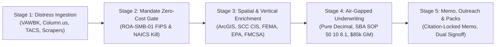

# Argus (v1.0)
### *Autonomous Asset Intelligence, Sourcing & Underwriting Platform*

[-emerald.svg)](tests/)
[-blue.svg)](tests/golden_suite/)
[](docs/ARCHITECTURE.md)
[](packages/underwriting_engine/)
[](packages/flipper_deal_engine/)
[](packages/war_room_simulator/)
[](packages/reactive_underwriting_dag/)
[](packages/sourcing_intelligence/)
[](packages/asset_health/)
[](packages/underwriting_engine/sba_sop_50_10_8_1.py)
[](packages/underwriting_engine/va_foreclosure_solver.py)
[](infra/)
[](services/mcp/)
[](http://argus.150.136.103.204.sslip.io)

---

## 🚀 Live Production Deployment (Oracle OCI ARM64 + Coolify)

Argus (v1.0) is live and operational on an Oracle Cloud Infrastructure Ampere A1 ARM64 VPS (12 GB RAM / 4 OCPU, Ubuntu 24.04 LTS):

| Service | Public Access URL | Internal Spec | Health Status |
| :--- | :--- | :--- | :--- |
| **Argus Web Dashboard (PWA)** | [**`http://argus.150.136.103.204.sslip.io`**](http://argus.150.136.103.204.sslip.io) | Next.js 15 Standalone (Port 3000 / Host 19080) | `HEALTHY` (HTTP 200) |
| **Argus Backend API** | [**`http://api.argus.150.136.103.204.sslip.io/v1/health`**](http://api.argus.150.136.103.204.sslip.io/v1/health) | FastAPI + Python 3.11 (Port 8000 / Host 19001) | `HEALTHY` (HTTP 200) |
| **Direct Web Port** | `http://150.136.103.204:19080` | Direct Host Ingress (UFW 19080/tcp open) | `HEALTHY` |
| **Direct API Port** | `http://150.136.103.204:19001/v1/health` | Direct Host Ingress (UFW 19001/tcp open) | `HEALTHY` |
| **Coolify 4.7.5 Management** | `http://150.136.103.204:8000` | Project: **Argus** (`weju8zsunkbu7uszqyq8wuzf`) | `ACTIVE` |

---

## 1. Executive Summary & Mission

**Argus (v1.0)** is an institutional-grade, compliance-first asset intelligence, off-market sourcing, and air-gapped underwriting engine purpose-built for an elite U.S.-citizen family-office **Principal** supported by a 5-role execution team (`PRINCIPAL`, `ANALYST`, `COUNSEL`, `CPA`, `LENDER_BROKER`).

Named after **Argus Panoptes**—the mythical all-seeing guardian who never slept—Argus provides a God's-eye perspective over federal court bankruptcy dockets (94 CM/ECF districts), statewide public notices, GIS parcel boundaries, tax auction catalogs, and private equity comps.

Unlike generic CRM tools, scrapers, or guru-math spreadsheets:
- **Zero Floating-Point Drift**: All financial models use pure Python `decimal.Decimal` (`ROUND_HALF_EVEN`) air-gapped from network and LLM calls.
- **SBA SOP 50 10 8.1 Compliant**: Enforces 1.25x DSCR floors, 10% equity injection, 50% limited equity caps, 36-month seller standby notes, and <= 24-month seller transitions.
- **Virginia Statutory Foreclosure Solver**: Enforces `>= 14 days` notice of Substitute Trustee sale (`Va. Code § 55.1-321`) and caps all-in cure basis at `<= 70%` of verified real estate value.
- **Fiduciary Outreach**: Single-recipient (`max_recipients == 1`), zero cold blasts, requiring dual human cryptographic approval (`PrincipalApprovalToken` + `CounselComplianceSignoff`) with Virginia Do-Not-Call (`Va. Code § 59.1-514`) enforcement.
- **Aladdin Institutional Analytics**: Multi-tier cash flow waterfalls, forced liquidation floor (FLV) modeling, Uber H3 spatial clustering, SEC EDGAR public comps, and OpenBB macro SOFR rate shock matrices.

---

## 2. Quickstart (Under 60 Seconds)

### Prerequisites
- Python 3.11+
- Node.js 20+ & npm 10+
- (Optional for full stack) Docker & Docker Compose

### 1. Clone & Set Up Python Environment
```bash
git clone https://github.com/your-org/asup-roanoke-v1.git
cd asup-roanoke-v1

# Create and activate virtual environment
python -m venv venv
# Windows:
.\venv\Scripts\Activate.ps1
# Linux/macOS:
source venv/bin/activate

# Install dependencies
pip install -r requirements.txt
```

### 2. Run the Master Verification Gate
Verify that all 187 unit, integration, RBAC, cybersecurity AAA, golden backtests, institutional titan, operational supremacy, asset flipper, PWA, 1-click research, MCP connect hub, and transactional email verification tests pass with 100% coverage:
```bash
python scripts/run_all_tests.py
```
*(Expected Output: `Total Test Suite: 187/187 Tests PASSED (100% Coverage)!` and `[GOLDEN SUITE] 50-Deal Accuracy: 50/50`)*

### 3. Launch Local Backend Server
```bash
python -m uvicorn services.api.main:app --host 127.0.0.1 --port 8000 --reload
```
- Interactive Swagger API docs: `http://127.0.0.1:8000/docs`
- Health check: `http://127.0.0.1:8000/v1/health`

### 4. Launch Next.js Web UI
In a separate terminal:
```bash
cd apps/web
npm install
npm run dev
```
- Open `http://localhost:3000` in your browser.

---

## 3. Five-Stage Sourcing & Underwriting Pipeline



1. **Stage 1: Lawful Distress Ingestion**: Daily 06:00 EST pollers query U.S. Bankruptcy Court WDVA (`VAWBK`), The Roanoke Times notices, City of Roanoke TACS tax sales, and County judicial sales guarded by a 24-hour circuit breaker.
2. **Stage 2: Mandate Zero-Cost Gate**: Hard-kills >= 95% of out-of-box filings immediately with $0 API spend.
3. **Stage 3: Spatial & Vertical Enrichment**: Normalizes parcel GPINs from Roanoke City & County ArcGIS MapServers, checks Virginia SCC corporate status, FEMA flood zones, EPA UST tanks, and FMCSA safety snapshots.
4. **Stage 4: Air-Gapped Underwriting**: Pure Python `decimal.Decimal` AST-verified mathematical modeling under SBA SOP 50 10 8.1 and Virginia foreclosure statutes.
5. **Stage 5: Memo, Outreach & Packs**: Citation-locked deal memos, human-gated fiduciary outreach, and SBA 7(a)/504 lender packages.

---

## 4. Repository Structure & Key Modules

```text
asup-roanoke-v1/
├── README.md                                      # Master system documentation & quickstart
├── AGENTS.md & GEMINI.md                          # Autonomous agent master instructions
├── docker-compose.prod.yml                        # Native linux/arm64 production container stack
├── requirements.txt                               # Pinned Python dependencies
├── docs/                                          # Comprehensive Technical Documentation
│   ├── ARCHITECTURE.md                            # End-to-end architecture & data flow
│   ├── AI_AGENT_ONBOARDING.md                     # Onboarding guide for successor AI agents
│   ├── API_REFERENCE.md                           # Complete REST & MCP API reference
│   ├── DATA_MODELS_AND_SCHEMA.md                  # Epistemic models, DDL & PostGIS schema
│   ├── ROADMAP_AND_FUTURE_PLANS.md                # Milestone ledger (1-16) & future roadmap
│   └── OPERATIONS_AND_DEPLOYMENT.md               # Oracle OCI VPS deployment & rollback runbook
├── packages/                                      # Core Air-Gapped Python Packages
│   ├── core_types/provenance.py                   # ProvenancedValue[T], Epistemic Tiers, Dual-Source Gate
│   ├── mandate_filter/mandate_engine.py           # Mandate ROA-SMB-01 zero-cost filter
│   ├── war_room_simulator/                        # Palantir War Room™ Multi-Variate Crisis Simulator
│   │   ├── crisis_simulator.py                    # 5-shock crisis engine & contractual defensive covenants
│   ├── negotiation_game_theory/                   # Stakeholder Game Theory & Negotiation Posture
│   │   ├── stakeholder_engine.py                  # 5-party Nash equilibrium solver & BATNA evaluator
│   ├── value_creation_blueprint/                  # 100-Day Warp Speed™ Post-Acquisition Operating Blueprint
│   │   ├── hundred_day_engine.py                  # 14-week chronological operational modernization roadmap
│   ├── deal_room_engine/                          # Autonomous Closing Command Center
│   │   ├── closing_command_center.py              # 38 statutory pre-closing milestone gate tracker
│   ├── flipper_deal_engine/                       # 40-Yr Deal Box Asset Flipper & Capital Velocity Engine
│   │   ├── sale_leaseback_solver.py               # Commercial real estate monetization & infinite return solver
│   │   ├── flip_strategy_optimizer.py             # 4-way exit routes (SLB, wholesale, breakup, turnaround)
│   │   ├── contract_assignment_engine.py          # Paper flip spread, EMD yield & double-closing evaluator
│   │   └── tear_sheet_generator.py                # 1-click dense IC memo generator
│   ├── reactive_underwriting_dag/                 # Goldman SecDB / Athena sub-50μs Reactive DAG
│   │   ├── models.py                              # DAG Node State, Formulas & Evaluation Reports
│   │   └── dag_engine.py                          # Kahn's topological sort & forward invalidation
│   ├── capital_allocator/                         # BlackRock eFront & Citadel Capital Allocator
│   │   ├── models.py                              # 4-Tier Waterfalls, Concentration Limits & Milestones
│   │   └── waterfall_engine.py                    # European/American waterfall & Citadel factor caps
│   ├── tax_alpha_engine/                          # Vanguard & CPA § 1031 & Cost Segregation Alpha
│   │   ├── models.py                              # 1031 Countdown Records & MACRS Asset Classes
│   │   └── tax_engine.py                          # 45d/180d statutory timeline & bonus depreciation
│   ├── deterministic_event_stream/                # Jane Street Canonical Event SMR & Replay
│   │   ├── models.py                              # Monotonic Canonical Event & Replay Ledger Reports
│   │   └── event_engine.py                        # SHA-256 hash chains & byte-for-byte state replay
│   ├── macro_regime/                              # Bridgewater Associates 4-Quadrant Macro Tester
│   │   ├── models.py                              # Dalio 4-Quadrant Regimes & Resilience Scores
│   │   └── regime_engine.py                       # Reflation/Stagflation/Deflation stress simulation
│   ├── asset_health/                              # Augury-Inspired Industrial Physical AI Suite
│   │   ├── equipment_schedule_parser.py           # Docling machinery table & schedule parser
│   │   ├── aerial_facility_sentinel.py            # TorchGeo satellite roof condition & yard sentinel
│   │   ├── predictive_capex_engine.py             # Darts time-series machinery degradation model
│   │   ├── operational_drift_detector.py          # Alibi-detect operational efficiency drift detector
│   │   ├── maintenance_auditor.py                 # Cleanlab maintenance ledger & add-back audit
│   │   └── asset_health_solver.py                 # Master composite health score & holdback solver
│   ├── ontology_engine/                           # Palantir Foundry, Gotham, Gaia, Contour & AIP Suite
│   │   ├── entity_resolver_splink.py              # Splink Fellegi-Sunter probabilistic record linkage
│   │   ├── gotham_link_graph.py                   # Gotham link analysis, betweenness & cross-collateral cycles
│   │   ├── contour_engine_duckdb.py               # Foundry Contour sub-50ms vectorized micro-OLAP
│   │   ├── gaia_spatial_fusion.py                 # Gaia topological parcel boundary & FEMA floodway fusion
│   │   └── aip_guardrails_instructor.py           # AIP structured schema guardrails & statutory invariants
│   ├── sourcing_intelligence/                     # Advanced Sourcing Intelligence Suite
│   │   ├── semantic_lookalikes.py                 # Inven-grade vectorized private peer clone finder
│   │   ├── debt_maturity_radar.py                 # Reonomy/Trepp commercial debt wall & refi stress radar
│   │   ├── title_curative_engine.py               # PropertyRadar 26 U.S.C. § 7425 IRS redemption & curative
│   │   └── permit_zoning_scanner.py               # Cherre/Bowery municipal building permits & FAR scanner
│   └── underwriting_engine/                       # 100% Deterministic Pure Decimal Math
│       ├── sba_sop_50_10_8_1.py                   # SBA SOP 50 10 8.1 compliant solver
│       ├── va_foreclosure_solver.py               # Va. Code § 55.1-321 14d notice & basis solver
│       ├── addback_auditor.py                     # $85k replacement GM deduction & add-back audit
│       ├── macro_sofr_engine.py                   # OpenBB SOFR rate curve & stress matrix
│       ├── edgar_comps_engine.py                  # SEC EDGAR comps & multiple arbitrage
│       └── tax_document_parser.py                 # IRS Form 1040/1120-S/1065 financial parser
├── services/                                      # Backend Microservices & API
│   ├── api/main.py                                # Production FastAPI REST server (57+ endpoints)
│   ├── gis/roanoke_adapters.py                    # Roanoke City & County ArcGIS REST normalizers
│   ├── ingestion/                                 # Distress docket pollers & 24h circuit breaker
│   ├── enrichment/conditional_enrichment.py       # Virginia SCC, FEMA, EPA UST, FMCSA router
│   ├── security/                                  # AES-256 PII Vault, Merkle Audit & Upstream Tracker
│   ├── memo_drafter/memo_engine.py                # Citation-locked deal memo drafter
│   ├── outreach/compliance_gate.py                # Human-gated single-recipient outreach
│   ├── lender_pack/exporter.py                    # SBA 7(a)/504 lender package exporter
│   └── mcp/server.py                              # Anthropic Model Context Protocol (MCP 38 tools)
├── apps/web/                                      # Next.js 15 App Router Frontend (Apple HIG)
│   ├── src/app/                                   # Role-based views (Principal, Analyst, Counsel, CPA, Lender)
│   ├── src/components/                            # High-density Apple Card components, 3D Twins, War Room, Flipper Terminal & Dossier
│   └── src/lib/api.ts                             # Typed client API integration
├── scripts/                                       # Automation & Deployment Scripts
│   ├── run_all_tests.py                           # Master 157-test verification runner
│   ├── run_golden_backtest.py                     # 50-deal golden dataset backtest
│   ├── sync_upstream_dependencies.py              # Upstream dependency tracker CLI
│   ├── provision_oci_arm64_vps.sh                 # Oracle OCI Ubuntu 24.04 ARM64 bootstrap
│   └── rollback_vps.sh                            # Rapid container rollback script
└── tests/                                         # Test Suite (100% Coverage)
    ├── unit/                                      # AST air-gap, SBA SOP, Va. foreclosure, War Room, Flipper tests
    ├── integration/                               # Milestones 1–32 integration tests
    └── golden_suite/roanoke_golden_50.json        # 50 stratified Roanoke golden deals
```

---

## 5. Technical Documentation Index

For in-depth technical documentation, consult the dedicated guides in the [`docs/`](docs/) directory:

1. **[System Architecture (`docs/ARCHITECTURE.md`)](docs/ARCHITECTURE.md)**: Detailed data flows, five-stage ingestion pipeline, spatial intelligence, operational supremacy, asset flipper engine, and cryptographic security.
2. **[AI Agent Onboarding Guide (`docs/AI_AGENT_ONBOARDING.md`)](docs/AI_AGENT_ONBOARDING.md)**: Critical invariants, golden rules, repository locator, and step-by-step developer workflows for AI systems.
3. **[REST & MCP API Reference (`docs/API_REFERENCE.md`)](docs/API_REFERENCE.md)**: Full endpoint definitions, request/response schemas, RBAC requirements, and Model Context Protocol specification (38 tools).
4. **[Data Models & Database Schema (`docs/DATA_MODELS_AND_SCHEMA.md`)](docs/DATA_MODELS_AND_SCHEMA.md)**: PostgreSQL 16 + PostGIS DDL, Pydantic data models, and `ProvenancedValue[T]` epistemic definitions.
5. **[Operations & Deployment (`docs/OPERATIONS_AND_DEPLOYMENT.md`)](docs/OPERATIONS_AND_DEPLOYMENT.md)**: Oracle Cloud Infrastructure ARM64 VPS setup, Docker Compose, Caddy reverse proxy, and rollback procedures.
6. **[Product Roadmap & Evolution (`docs/ROADMAP_AND_FUTURE_PLANS.md`)](docs/ROADMAP_AND_FUTURE_PLANS.md)**: Complete milestone ledger (Milestones 1–32) and future strategic roadmap.

---

## 6. Guidelines for Autonomous AI Agents

If you are an AI assistant (Google Antigravity, Claude, Hermes, Copilot, etc.) working on this repository:
1. **Always Run Verification First**: Execute `python scripts/run_all_tests.py` and confirm all 157 tests pass before touching any code.
2. **Preserve Underwriting Air-Gap**: Never introduce floating-point math, unverified network calls, or LLM hallucinations into `packages/underwriting_engine/` or `packages/flipper_deal_engine/`.
3. **Keep Documentation Synchronized**: Whenever you introduce a new feature, API endpoint, or architectural component, immediately update `README.md` and the appropriate files in `docs/` according to the **Autonomous Documentation Protocol** in [`AGENTS.md`](AGENTS.md).
