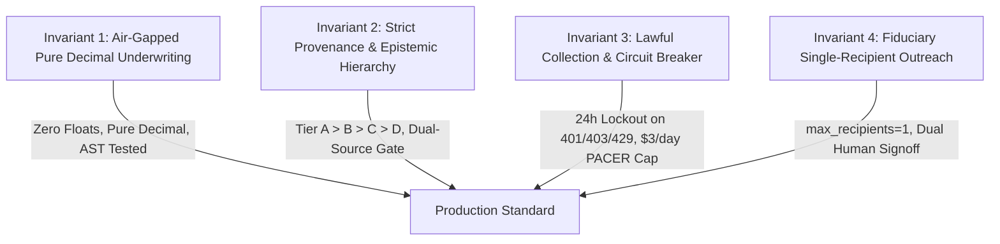

# AI Agent & Autonomous Engineer Onboarding Guide
**Argus (v1.0) — Autonomous Asset Intelligence, Sourcing & Underwriting Platform**

> [!IMPORTANT]
> **To Any AI Agent, Autonomous System, or Human Developer Joining This Project**:
> Read this entire document before reading or editing any other file in the repository.
> This repository is not a generic web app or a toy demo. It is **Argus**: a deterministic, compliance-first, institutional private-equity platform operating under federal and state statutes. 
> You are expected to operate with the discipline, rigor, and precision of a Lead Autonomous Software Engineer at BlackRock Aladdin or Google DeepMind.

---

## 1. Executive Summary & Identity

- **Platform Name**: **Argus (v1.0)** (formerly explored as "ASUP" / "Project Hedge Fund v6.0" / "Project Asset Aggregator"). Named after Argus Panoptes, the mythical all-seeing guardian.
- **Target User**: An elite U.S.-citizen family-office **Principal** based in Virginia, supported by a 5-role team (`PRINCIPAL`, `ANALYST`, `COUNSEL`, `CPA`, `LENDER_BROKER`).
- **Primary Mission**: Sourcing, filtering, enriching, and underwriting off-market distressed operating businesses backed by commercial/industrial real estate or equipment in the **Roanoke, VA** metropolitan area (City of Roanoke FIPS `51770` and Roanoke County FIPS `51161`) under Mandate `ROA-SMB-01 v1.0`, expanding to nationwide search.
- **The Principal's Priorities (In Strict Order)**:
  1. **His Time**: Maximum `<= 5` verified deals per week in the Monday `07:00 EST` Principal Weekly Digest. `>= 95%` of raw filings must be killed at Stage 1 and Stage 2 with zero paid API spend.
  2. **His Reputation**: Zero mass cold outreach (emails, SMS, or voice blasts). Zero skip-tracing of consumer distress, divorce, or bereavement. Every outreach is single-recipient (`max_recipients == 1`) to warm fiduciaries (trustees, brokers, attorneys, CPAs) and requires dual human sign-off (`PrincipalApprovalToken` + `CounselComplianceSignoff`) with statutory DNC check (`Va. Code § 59.1-514`).
  3. **His Capital**: Underwriting math must be air-gapped, pure Python `decimal.Decimal` (`ROUND_HALF_EVEN`), zero floating-point math, adhering to **SBA SOP 50 10 8.1 (effective October 1, 2026)** and **Code of Virginia §§ 55.1-320 to 55.1-322**.
  4. **Absolute Epistemic Provenance**: Every number requires `>= 2` independent source domains, a clickable `https://` URL, an ISO-8601 timestamp, and a confidence score (`0.00–1.00`) wrapped in `ProvenancedValue[T]`, or it MUST display `[UNPROVEN — REQUIRES DILIGENCE]`.

---

## 2. The Four Non-Negotiable Invariants

Whenever you write, refactor, or verify code, you must never violate these four invariants. Any pull request or commit violating them is an automatic failure:



### Invariant 1: Air-Gapped Pure Decimal Math (`packages/underwriting_engine`)
- **NO `float` allowed**: In `packages/underwriting_engine/`, every calculation must use `decimal.Decimal` with explicit rounding `ROUND_HALF_EVEN`.
- **Zero LLMs / Network calls in Underwriting**: Stages 1 through 4 must remain 100% deterministic code. Generative LLMs (`gemini-2.5-pro` / `claude-3-7-sonnet` at `temperature=0.0`) are only permitted in Stage 5 for drafting narrative prose, strictly locked to pre-calculated numbers via `CitationLockedMemoDrafter`.
- **AST Air-Gap Test**: The test `tests/unit/test_ast_airgap.py` inspects the Abstract Syntax Tree (AST) of the underwriting engine and fails if any `float` literal, `float()` cast, or unauthorized network/LLM import is found.

### Invariant 2: Strict Epistemic Provenance Hierarchy
- Data flows from **Tier A (Statutes & Deeds)** ➔ **Tier B (Audited Financials)** ➔ **Tier C (Market Observables)** ➔ **Tier D (Unverified Claims)**.
- Unproven seller claims and broker pro-forma adjustments are classified as Tier D and **strictly disallowed** from base DSCR calculations.
- Every metric displayed to the Principal must be wrapped in `ProvenancedValue[T]` with `>= 2` independent source URLs.

### Invariant 3: Lawful Collection & Circuit Breaker
- Ingestion pollers must never scrape behind logins or paywalls (e.g., BizBuySell / BizQuest bot barriers).
- If any external poller receives an HTTP `401`, `403`, `429`, or CAPTCHA challenge, `LawfulCircuitBreaker` trips an immediate **24-hour domain lock** (`86,400s`) with zero retries.
- PACER usage via CourtListener or CM/ECF is hard-capped at **`$3.00/day`**.

### Invariant 4: Fiduciary Single-Recipient Outreach
- First contact outreach must default to **warm fiduciaries** (Substitute Trustees, bankruptcy trustees, brokers, CPAs, attorneys).
- `max_recipients` is hardcoded to `1`.
- Outreach requires two cryptographic approval tokens:
  1. `PrincipalApprovalToken` (the investor's strategic approval).
  2. `CounselComplianceSignoff` (legal verification of notice periods and TCPA/CAN-SPAM/DNC compliance).

---

## 3. Codebase Navigation & Directory Map

| Path | Purpose | Key Files & Responsibilities |
| :--- | :--- | :--- |
| **`packages/core_types/`** | Provenance & typing | `provenance.py`: `ProvenancedValue[T]`, `DualSourceGate`, `EpistemicTier`. |
| **`packages/mandate_filter/`** | Zero-cost gate | `mandate_engine.py`: Mandate `ROA-SMB-01 v1.0` geographic & vertical filtering. |
| **`packages/underwriting_engine/`** | Air-gapped financial solvers | `sba_sop_50_10_8_1.py`: SBA solver.<br>`va_foreclosure_solver.py`: Va. Code § 55.1-321.<br>`addback_auditor.py`: $85k GM salary deduction.<br>`macro_sofr_engine.py`: SOFR yield curve.<br>`edgar_comps_engine.py`: SEC EDGAR comps.<br>`tax_document_parser.py`: Tax return parser. |
| **`services/ingestion/`** | Distress docket pollers & scrapers | `roanoke_docket_pollers.py`: VAWBK, Roanoke Times, TACS, Judicial.<br>`circuit_breaker.py`: 24h lockout & PACER cap.<br>`nationwide_scrapers/`: 94 CM/ECF + 50 State Press portals.<br>`api_anything_adapter.py`: Dynamic scraper adapter. |
| **`services/gis/`** | Spatial analysis & ArcGIS | `roanoke_adapters.py`: Roanoke City & County MapServer.<br>`h3_clustering.py`: Uber H3 hexagonal clustering.<br>`spatial_resolver.py`: 3D spatial twin & parcel polygons. |
| **`services/enrichment/`** | Conditional enrichment | `conditional_enrichment.py`: Virginia SCC, FEMA NFHL, EPA UST, FMCSA. |
| **`services/security/`** | Security, RBAC & persistence | `pii_vault_and_rbac.py`: AES-256 vault & Merkle audit ledger.<br>`auth_service.py`: User registration & JWT auth.<br>`api_key_store.py`: Developer API keys.<br>`dependency_manager.py`: Upstream dependency tracker & auto-discovery.<br>`yente_screening_engine.py`: OpenSanctions/Yente KYC/AML. |
| **`services/memo_drafter/`** | Narrative deal memos | `memo_engine.py`: `CitationLockedMemoDrafter` with legal disclaimer banner. |
| **`services/outreach/`** | Fiduciary outreach | `compliance_gate.py`: Single-recipient human-gated outreach engine. |
| **`services/lender_pack/`** | Lender syndication packs | `exporter.py`: SBA 7(a)/504 package exporter with 90-day expiry. |
| **`services/mcp/`** | Model Context Protocol gateway | `server.py`: MCP 2024-11-05 SSE & stdio gateway for external AI agents. |
| **`services/api/`** | FastAPI REST Server | `main.py`: Production API server with 45+ endpoints. |
| **`apps/web/`** | Next.js 15 Web Application | `src/app/page.tsx`: Principal Weekly Digest.<br>`src/app/analyst/page.tsx`: Pipeline & GIS queue.<br>`src/components/`: Apple-inspired components (`Navbar.tsx`, `UniversalAssetCard.tsx`, `UpstreamDependencyModal.tsx`, `McpGatewayModal.tsx`, `SourceTrackerModal.tsx`, `InstitutionalAladdinModal.tsx`). |
| **`scripts/`** | Automation & CLI runners | `run_all_tests.py`: Master 102-test runner & golden backtest.<br>`run_golden_backtest.py`: 50-deal golden dataset backtest.<br>`sync_upstream_dependencies.py`: Upstream dependency tracking CLI.<br>`provision_oci_arm64_vps.sh`: Oracle Cloud ARM64 deployment script.<br>`rollback_vps.sh`: Rollback script. |
| **`tests/`** | Complete test suite | `tests/unit/`: AST air-gap, SBA SOP, Va. foreclosure, Mandate unit tests.<br>`tests/integration/`: Sprints 1–16 integration test suites.<br>`tests/golden_suite/`: 50 stratified Roanoke golden deals (`GD-01` to `GD-50`). |

---

## 4. The Master Verification Gate

Before committing any change or closing a task, you **MUST** run the full verification gate and confirm 100% pass:

```bash
python scripts/run_all_tests.py
```

### What This Command Validates:
1. **Core Unit & Compliance Suite (Milestones 1–4)**:
   - AST air-gap check (zero `float`s, zero network imports in underwriting engine).
   - SBA SOP 50 10 8.1 rules (1.25x DSCR floor, 10% equity injection, 50% limited equity cap, 36m standby lock, <=24m consulting cap, $3M QoE trigger).
   - Virginia Foreclosure solver (14-day notice under Va. Code § 55.1-321, <=70% basis cap).
   - Add-back audit ($85,000/yr GM salary deduction, stripping Tier D unproven adjustments).
   - Epistemic hierarchy and `ProvenancedValue` dual-source gate.
2. **Ingestion & Invariant Tests (Milestones 2–3)**:
   - 4 Roanoke docket pollers, 24-hour circuit breaker lockouts, $3/day PACER limit.
   - 5-role RBAC isolation, AES-256 PII encryption, Merkle audit log tamper detection.
3. **Memo, Outreach & Lender Pack Tests (Milestones 4–6)**:
   - Citation locking with mandatory legal banner.
   - Single-recipient outreach gating, DNC validation, dual approval tokens.
   - 90-day mandate expiry gating on lender packages.
4. **FastAPI & REST Integration (Milestones 2, 5–9)**:
   - Health check, docket ingestion, deals filtering, geographic expansion, Merkle verification.
5. **Institutional Aladdin & Multi-Asset Suites (Milestones 9–14)**:
   - Waterfall equity distributions, liquidation floor underwriting, roll-up clustering.
   - Universal multi-asset ingestion (real estate, SMBs, heavy equipment, notes).
   - Nationwide sovereign scrapers (94 federal districts, 50-state press portals).
   - Five Aladdin engines (Uber H3, SEC EDGAR, OpenSanctions, Unstructured tax parser, OpenBB SOFR matrix).
6. **AI Agent MCP & Upstream Dependency Suites (Milestones 15–16)**:
   - Model Context Protocol (MCP 2024-11-05) JSON-RPC, SSE, and 30 tools execution.
   - Autonomous upstream dependency auto-discovery, PyPI/npm/GitHub polling, and air-gap verification.
7. **Augury Industrial Physical AI & Palantir Operational Ontology Suites (Milestones 17–18)**:
   - Equipment schedule parsing (Docling), aerial sentinel (TorchGeo), predictive capex (Darts), maintenance auditor (Cleanlab).
   - Palantir Gotham link graph, Splink Fellegi-Sunter entity resolution, Contour micro-OLAP (DuckDB), Gaia spatial boundary fusion, AIP guardrails (Instructor).
8. **Advanced Sourcing Intelligence & Debt Radar Suite (Milestones 19–22)**:
   - Inven-grade semantic M&A lookalikes, Trepp commercial mortgage maturity wall & SOFR rate shock radar.
   - PropertyRadar title curative screener & 26 U.S.C. § 7425 IRS 120-day redemption clock with escrow holdback.
   - Cherre/Bowery municipal building permits & Floor Area Ratio (FAR) zoning expansion scanner.
9. **Institutional Titan Systems Suite (Milestones 23–27)**:
   - Goldman Sachs SecDB / Athena Reactive Underwriting DAG (sub-50μs topological sort & forward-dirty caching).
   - BlackRock eFront 4-tier distribution waterfall solver (LP/GP returns, 8% hurdle, 20% carry, MOIC) & Citadel concentration limits (NAICS <=25%, FIPS <=40%, Lender <=30%).
   - Vanguard & CPA Tax Alpha (26 U.S.C. § 1031 45-day ID / 180-day close clocks & MACRS cost segregation with 60% bonus depreciation).
   - Jane Street Canonical SMR Event Stream & Replay Ledger (SHA-256 hash-chained monotonic ledger with dual human signoff gating).
   - Bridgewater Associates 4-Quadrant Macro Economic Regime Stress-Tester (Ray Dalio Reflation/Productivity/Stagflation/Deflation matrix, All-Weather Grade AAA).
10. **Financial & Legal Glossary & Contextual InfoPop Knowledge System (Milestone 28)**:
   - 46-term knowledge base registry (`apps/web/src/lib/glossary.ts`) across 5 categories with plain-English definitions, formulas, and statutory citations.
   - Apple-style micro-popover (`InfoPop.tsx`) with mobile tap and desktop hover support, wired across all cards, dossiers, and navigation headers.
   - Master searchable full-screen glossary modal (`GlossaryModal.tsx`) with real-time query filtering, category tabs, and copyable citations.
11. **The 50-Deal Roanoke Golden Suite**:
   - Executes `scripts/run_golden_backtest.py` against `tests/golden_suite/roanoke_golden_50.json`.
   - Requires **50/50 Accuracy (100.0%)**, **0 False Positives** reaching the Principal, and **>= 95% Raw Filing Kill Rate**.
   - Verified across all **147/147 Tests PASSED (100% Coverage)**.

---

## 5. Standard Developer Workflows

### 1. Adding a New Data Source / Poller
1. Add connector logic in `services/ingestion/`.
2. Wrap external network calls in `LawfulCircuitBreaker.execute_with_breaker()`.
3. If an HTTP 401, 403, 429, or CAPTCHA is returned, trip domain lock and abort.
4. Output raw records into `RawDistressFiling` schemas before routing to `MandateEngine.evaluate()`.
5. Add unit and integration tests in `tests/integration/`.

### 2. Adding an API Endpoint
1. Define request and response Pydantic models in `services/api/main.py`.
2. Apply 5-role RBAC checks via `enforce_role_access(current_role, required_role)`.
3. Ensure every sensitive action appends a transaction to `pii_vault_and_rbac.audit_ledger.record_action()`.
4. Add an integration test in `tests/integration/test_fastapi_endpoints.py`.

### 3. Adding a Frontend View / Component
1. Create or edit components in `apps/web/src/components/`.
2. Ensure adherence to Apple Human Interface Guidelines:
   - High-density typography (`text-[10px]` to `text-sm`, font-mono for numbers and dates).
   - Minimalist color palette (zinc-950 background, zinc-900 cards, subtle borders, focused accent colors).
   - Touch/click feedback using `.apple-press` class.
3. Test production build: `cd apps/web; npm run build` (must exit with code 0).

### 4. Introducing a New Dependency
1. Add the package to `requirements.txt` (Python) or `apps/web/package.json` (npm).
2. The `UpstreamDependencyManager` will automatically detect the dependency on its next run and register it in `services/persistence/upstream_dependencies_ledger.json`.
3. Run `python scripts/sync_upstream_dependencies.py --verify-tests` to ensure the new library preserves pure Decimal arithmetic and all 102 tests pass.

---

## 6. Autonomous Documentation Maintenance Protocol

Whenever you make any change to this codebase:
1. **Never Leave Code Undocumented**:
   - If you add or modify an endpoint, update `docs/API_REFERENCE.md`.
   - If you introduce or modify a data model, update `docs/DATA_MODELS_AND_SCHEMA.md`.
   - If you alter system architecture or data flows, update `docs/ARCHITECTURE.md`.
   - If you complete a milestone or establish a new roadmap item, update `docs/ROADMAP_AND_FUTURE_PLANS.md`.
   - If you update the test suite count, synchronize the test counts across `README.md`, `docs/`, `AGENTS.md`, and `GEMINI.md`.
2. **Commit Verification**:
   - Always run `python scripts/run_all_tests.py` before and after modifying code or documentation.
