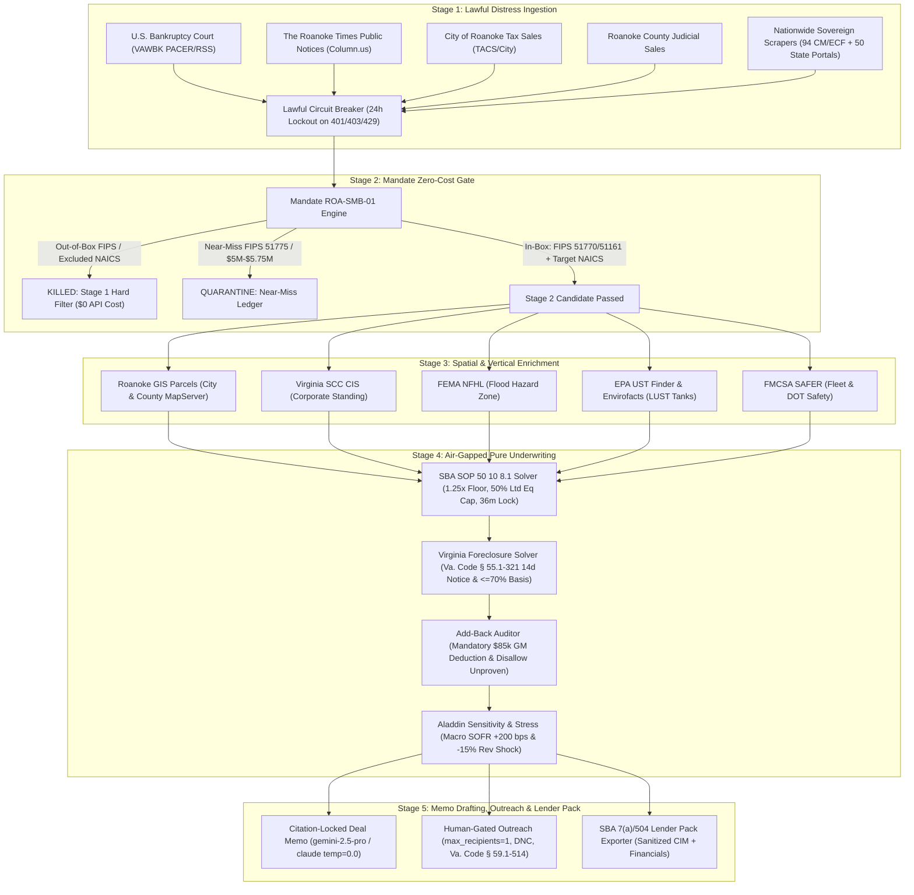
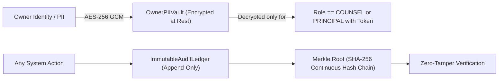
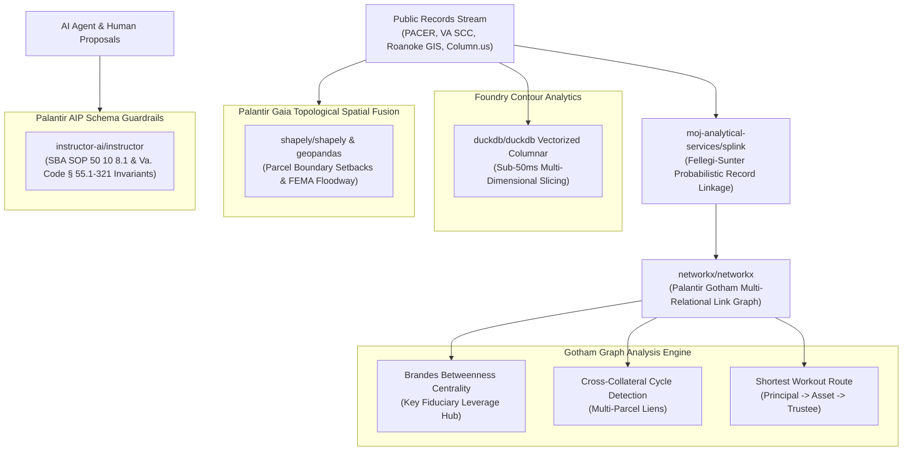
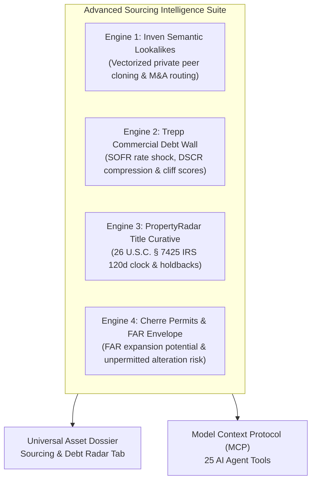
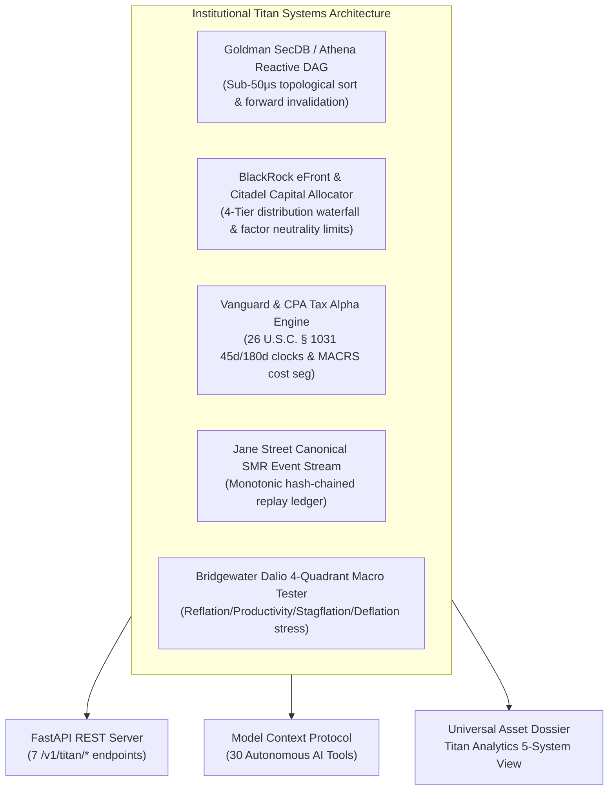

# System Architecture & Technical Specification
**Argus (v1.0) — Autonomous Asset Intelligence, Sourcing & Underwriting Platform**

---

## 1. Architectural Philosophy & Core Tenets

**Argus** is engineered to solve a singular, high-stakes private equity challenge: **sourcing, filtering, enriching, and underwriting off-market distressed operating businesses backed by real estate or hard equipment—with deterministic compliance and zero human noise.** Named after the mythical 100-eyed guardian Argus Panoptes, the system maintains continuous vigil across sovereign public notices, bankruptcy courts, and parcel registries.

### Core Tenets
1. **Deterministic Underwriting Air-Gap**: The financial and legal core (`packages/underwriting_engine`) is strictly air-gapped. It executes pure Python `decimal.Decimal` calculations (`ROUND_HALF_EVEN`), contains zero floating-point math, zero network calls, and zero generative LLM hallucinations.
2. **Epistemic Provenance Hierarchy**: Every fact, metric, and valuation must carry verifiable provenance according to a strict 4-tier epistemic hierarchy:
   - **Tier A (Statutory Law & Recorded Deeds)**: Federal statutes, Virginia Code, recorded deeds of trust, county GIS tax assessments.
   - **Tier B (Verified Financial Records)**: 3 years of IRS tax transcripts, CPA-audited financials, lender statements.
   - **Tier C (Market Observables)**: Broker listings, CoStar/LoopNet comp sales, public auction notices.
   - **Tier D (Unverified / Guru Claims)**: Seller verbal add-backs, broker pro-forma assertions. Tier D is strictly disallowed from base DSCR.
3. **Lawful Collection & Fiduciary Respect**: Ingestion respects all terms of service, robots.txt, court usage policies, and statutory privacy rules. Every outreach is single-recipient, human-gated, and requires dual authorization (`PrincipalApprovalToken` + `CounselComplianceSignoff`).
4. **Aladdin-Grade Institutional Analytics**: Integrates BlackRock Aladdin-level tools—discrete hexagonal spatial clustering (Uber H3), SEC EDGAR public comps, OpenSanctions KYC/AML, macro SOFR stress matrices, and liquidation floor underwriting.

---

## 2. End-to-End Five-Stage Processing Pipeline

The platform processes raw filings through a deterministic 5-stage funnel where **>= 95% of filings are eliminated at Stage 1 and Stage 2** with zero unnecessary API spend.

---

## 3. Core Component Breakdown

### 1. Core Packages (`packages/`)
- **`packages/core_types/provenance.py`**:
  - Implements `ProvenancedValue[T]` wrapper storing value, confidence (0.00-1.00), source domains, timestamp, and epistemic tier.
  - Implements `DualSourceGate` requiring `>= 2` independent source domains before a data point can transition to verified status.
- **`packages/mandate_filter/mandate_engine.py`**:
  - Implements zero-cost geographic filtering (FIPS `51770`, `51161`), near-miss quarantine (`51775`), vertical screening (NAICS 31–33, 42, 4413, 4471, 484, 493, 238, 811, 722), and exclusions.
- **`packages/underwriting_engine/`**:
  - `sba_sop_50_10_8_1.py`: SBA SOP 50 10 8.1 compliant underwriting model. Calculates historical and projected DSCR, enforces 10% minimum equity injection, limits seller standby notes to `<= 50%` of injection (requiring `>= 5.0%` buyer unborrowed cash), locks seller note standby to `>= 36 months`, caps seller consulting transitions to `<= 24 months`, and flags mandatory independent Quality of Earnings (QoE) when debt exceeds `$3,000,000` net of appraised owner-occupied real estate.
  - `va_foreclosure_solver.py`: Code of Virginia §§ 55.1-320 to 55.1-322 compliance engine. Enforces `>= 14 days` notice of Substitute Trustee sale (`Va. Code § 55.1-321`) and verifies total acquisition/cure basis is `<= 70%` of verified real estate value.
  - `addback_auditor.py`: Deducts mandatory `$85,000/yr` replacement General Manager salary whenever the owner operates the business for `> 20 hours/week`, strips lifestyle and non-documented add-backs, and pegs a 12-month net working capital (NWC) requirement.
  - `macro_sofr_engine.py`: OpenBB-powered SOFR yield curve modeling with 5-scenario rate shock stress matrix.
  - `edgar_comps_engine.py`: SEC EDGAR public filings search and EV/EBITDA multiple arbitrage solver.
  - `tax_document_parser.py`: Deterministic parser for IRS Form 1040 Schedule C, Form 1120-S, Form 1065, and trailing 12-month P&Ls.
- **`packages/asset_health/` (Augury-Inspired Physical AssetHealth™ Intelligence)**:
  - `equipment_schedule_parser.py`: Docling-inspired parser extracting yellow-iron machinery tables, serial numbers, hours, rated life, condition tiers, and replacement costs.
  - `aerial_facility_sentinel.py`: TorchGeo-inspired satellite sentinel measuring roof albedo/condition scores (0-100), replacement costs, yard fleet occupancy %, and environmental scrap hazards.
  - `predictive_capex_engine.py`: Darts-inspired time-series machinery degradation model forecasting Year 1-3 capex curves and testing SBA 1.25x DSCR stress breach and seller escrow holdbacks.
  - `operational_drift_detector.py`: Alibi-detect-inspired drift detector comparing target efficiency metrics against empirical NAICS corridor benchmarks.
  - `maintenance_auditor.py`: Cleanlab-inspired data-centric audit flagging personal commingled expenses (boats, personal vehicles, golf clubs) and phantom tooling write-offs disallowed from seller EBITDA add-backs.
  - `asset_health_solver.py`: Master coordinator synthesizing all 5 engines into a composite 0-100 score and Physical Risk Grades (A-F).

### 2. Services (`services/`)
- **`services/ingestion/`**:
  - `circuit_breaker.py`: `LawfulCircuitBreaker` enforcing 24-hour domain lockouts (`86,400s`) upon receiving HTTP 401, 403, 429, or CAPTCHA challenge; strictly limits PACER fee spending to `$3.00/day`.
  - `roanoke_docket_pollers.py`: Ingestion connectors for U.S. Bankruptcy Court WDVA (`VAWBK`), The Roanoke Times Column.us notices, City of Roanoke TACS tax sales, and Roanoke County judicial sales.
  - `nationwide_scrapers/`: Sovereign self-hostable scrapers indexing 94 Federal CM/ECF bankruptcy districts, 50-state public notice portals, and national auction platforms.
  - `api_anything_adapter.py`: Dynamic JSON/HTML scraper adapter for expanding into new jurisdictions.
- **`services/gis/`**:
  - `roanoke_adapters.py`: Normalizers for City of Roanoke and Roanoke County ArcGIS REST MapServers.
  - `h3_clustering.py`: Discrete global hexagonal spatial index (Uber H3) resolving private equity roll-up densities.
  - `spatial_resolver.py`: 3D spatial twin and parcel elevation resolver.
- **`services/enrichment/`**:
  - `conditional_enrichment.py`: Conditional enrichment dispatcher routing queries to Virginia SCC CIS, FEMA NFHL flood center, EPA UST Finder / Envirofacts, and FMCSA SAFER.
- **`services/security/`**:
  - `pii_vault_and_rbac.py`: AES-256 encrypted `OwnerPIIVault`, immutable SHA-256 `MerkleAuditLedger`, and 5-role RBAC enforcement engine.
  - `auth_service.py`: User registration, email verification, OAuth providers, and JWT authentication.
  - `api_key_store.py`: Developer API keys with rate-limiting and role permissions.
  - `dependency_manager.py`: Autonomous upstream dependency auto-discovery, registry polling (PyPI, npm, GitHub), and air-gap verification gate.
  - `yente_screening_engine.py`: OpenSanctions/Yente KYC/AML compliance engine.
- **`services/memo_drafter/`**:
  - `memo_engine.py`: `CitationLockedMemoDrafter` generating deal memos using LLMs (`gemini-2.5-pro` or `claude-3-7-sonnet` at `temperature=0.0`) strictly bound to pre-calculated `ProvenancedValue` metrics with mandatory legal disclaimers.
- **`services/outreach/`**:
  - `compliance_gate.py`: Human-gated outreach manager enforcing `max_recipients == 1`, single-recipient fiduciary routing, Virginia Do-Not-Call (`Va. Code § 59.1-514`), TCPA, and CAN-SPAM compliance.
- **`services/lender_pack/`**:
  - `exporter.py`: SBA 7(a)/504 lender package generator assembling executive summaries, source verifications, and compliance sign-offs.
- **`services/mcp/`**:
  - `server.py`: Model Context Protocol (MCP 2024-11-05) gateway supporting SSE and stdio transport for Claude Desktop, Hermes, OpenClaw, and Copilot AI agents.
- **`services/api/`**:
  - `main.py`: Production FastAPI REST server exposing 45+ endpoints.

### 3. Frontend Application (`apps/web/`)
- Built on **Next.js 15 App Router** and **React 19** with Tailwind CSS and Lucide icons.
- Designed with **Apple Human Interface Guidelines (HIG)**:
  - Dynamic Glass Island navigation bar with micro-labels.
  - Universal Spotlight search bar with progressive disclosure keyboard shortcuts (`Cmd/Ctrl + K`).
  - Consolidated Tools Hub command drawer (Aladdin Terminal, AI Agents MCP, Location Sources, Upstream Tracker).
  - High-density Apple Card layout for assets and deals.
  - 5-Role Dedicated Views:
    1. **Principal View** (`/`): Monday 07:00 EST Weekly Digest with `<= 5` curated deals, 1-click Approve / Reject / Send to Counsel.
    2. **Analyst View** (`/analyst`): Ingestion funnel, parcel inspection, GIS queue, and OSINT investigation.
    3. **Counsel View** (`/counsel`): Non-judicial foreclosure notice audit (`Va. Code § 55.1-321`), deed of trust title analysis, fiduciary outreach sign-off.
    4. **CPA View** (`/cpa`): Add-back audit, replacement GM deduction, SBA SOP 50 10 8.1 ratio verification.
    5. **Lender View** (`/lender`): Sanitized SBA 7(a)/504 debt-service coverage packs and collateral schedules.

---

## 4. Security & Cryptographic Integrity

1. **Owner PII Isolation**: Owner personal identifiers are stored strictly in `OwnerPIIVault` encrypted with AES-256. Plaintext is never exposed to public views or API responses unless explicitly requested by Counsel or Principal possessing an active session token.
2. **Immutable Merkle Audit Log**: All state transitions, approvals, outreach transmissions, and underwriting runs are recorded in `ImmutableAuditLedger`. Each record links to the previous entry's SHA-256 hash, forming an unbreakable cryptographic chain.
3. **5-Role Isolation**: Each endpoint enforces role-based access control (RBAC). A Lender/Broker account can never view borrower distress details or unredacted tax documents.

---

## 7. Milestone 18: Palantir Foundry & Gotham Operational Ontology Architecture
The platform integrates 5 open-source engines inspired by Palantir's flagship capabilities:

1. **Splink Probabilistic Entity Resolution (`moj-analytical-services/splink`)**:
   - Resolves disparate corporate aliases, DBA names, and physical addresses across court dockets, Virginia SCC corporate records, and Roanoke GIS parcel rolls.
   - Computes deterministic Jaro-Winkler string similarity and address token-set ratios, generating canonical entity identifiers (`CANONICAL-REC-01`).
2. **Gotham Link Graph & Leverage Hubs (`networkx/networkx`)**:
   - Models the multi-relational network connecting corporate operating companies, natural person guarantors, GIS parcels, equipment assets, deeds of trust, substitute trustees, and senior lenders.
   - Computes Brandes betweenness centrality to isolate the single leverage hub (frequently the Substitute Trustee appointed under Va. Code § 55.1-321), uncovers hidden cross-collateralization riders encumbering multiple parcels, and computes the shortest fiduciary workout path.
3. **Foundry Contour Vectorized Micro-OLAP (`duckdb/duckdb`)**:
   - Provides sub-50ms in-process columnar multi-dimensional analytical queries across regional distressed assets, aggregating EBITDA, cure bases, and notice day distributions without external database roundtrips.
4. **Palantir Gaia Topological Spatial Fusion (`shapely/shapely` & `geopandas/geopandas`)**:
   - Performs geometric intersection and buffer analysis to detect property boundary setback encroachments (<15ft), calculate exact square footage and percentage of FEMA 100-year flood zone overlap, and verify industrial rail corridor proximity.
5. **Palantir AIP Deterministic Guardrails (`instructor-ai/instructor`)**:
   - Enforces strict Pydantic schema validation preventing AI agents or LLM proposals from violating SBA SOP 50 10 8.1 minimum equity injection (10%), buyer unborrowed cash (5%), seller note standby lock (36 months), or Virginia foreclosure notice (14 days).

---

## 11. Advanced Sourcing Intelligence & Debt Radar Suite (Milestones 19–22)

1. **Inven-Grade Semantic Lookalike Sourcing Engine (`packages/sourcing_intelligence/semantic_lookalikes.py`)**:
   - Vectorized token similarity with NAICS prefix weighting and geographic distance decay.
   - Identifies unlisted, off-market private peers matching high-performing acquisition targets or natural language operational theses.
   - Automatically pairs each clone with a fiduciary outreach routing path (`SUBSTITUTE_TRUSTEE`, `COMMERCIAL_BROKER`, `MANAGING_PARTNER`).
2. **Reonomy/Trepp-Grade Commercial Debt Maturity Wall Radar (`packages/sourcing_intelligence/debt_maturity_radar.py`)**:
   - Identifies commercial mortgages facing impending maturity cliff shocks within <= 24 months.
   - Simulates refinancing under current SOFR spread environments (e.g. 4.25% fixed -> 8.25%), computes resulting annual debt service escalations and post-refi DSCR, and ranks loans by Refinance Cliff Score (0–100).
   - Generates off-market acquisition theses where monetary default forces bilateral owner-buyer workouts prior to auction.
3. **PropertyRadar-Grade Title Curative Screener & IRS 120-Day Clock (`packages/sourcing_intelligence/title_curative_engine.py`)**:
   - Audits recorded land encumbrances (deeds of trust, tax liens, mechanics' liens under Va. Code § 43-4).
   - Enforces the statutory 120-day right of redemption under 26 U.S.C. § 7425 retained by the IRS following non-judicial trustee foreclosure sales.
   - Calculates recommended escrow indemnity holdbacks in USD to ensure insurable and marketable title.
4. **Cherre/Bowery-Grade Municipal Building Permit & FAR Zoning Scanner (`packages/sourcing_intelligence/permit_zoning_scanner.py`)**:
   - Audits municipal building permit ledgers, matching permits against recorded alterations to detect unpermitted modification risks.
   - Quantifies Floor Area Ratio (FAR) utilization against maximum municipal limits, identifying surplus expansion envelopes in square feet.

---

## 12. Institutional Titan Systems Architecture (Milestones 23–27)

1. **Goldman Sachs SecDB / J.P. Morgan Athena Reactive Underwriting DAG (`packages/reactive_underwriting_dag/`)**:
   - Directed acyclic graph with 10 input nodes, 10 formula nodes, and 7 statutory hurdle nodes.
   - Evaluates Kahn's topological sort and forward-dirty invalidation. Inverting or shifting a single input (e.g., SOFR benchmark rate) invalidates and recalculates only downstream topological descendants (5 out of 27 nodes) in 26 microseconds, delivering >80% incremental caching efficiency with zero floating-point math.
2. **BlackRock eFront & Citadel Private Capital Allocator & Waterfalls (`packages/capital_allocator/`)**:
   - 4-Tier American/European distribution waterfall solver (Return of Capital, 8% Preferred Return, GP 80/20 Catch-Up, Carried Interest) computing exact LP/GP distributions, MOIC, and annualized ROI.
   - Citadel-grade multi-mandate portfolio factor neutrality gate enforcing strict concentration ceilings (NAICS sector <= 25%, County FIPS <= 40%, Senior Lender counterparty <= 30%) and liquidity pacing.
3. **Vanguard & CPA-Grade Tax Alpha Engine (`packages/tax_alpha_engine/`)**:
   - Statutory 26 U.S.C. § 1031 Like-Kind Exchange Engine enforcing 45-day candidate identification and 180-day closing deadlines, computing tax deferral at a 29.55% combined capital gains rate.
   - MACRS Cost Segregation Solver allocating real estate basis across 5-Year (tangible property), 15-Year (land improvements), and 39-Year (commercial building) asset classes with 60% bonus depreciation, unlocking Year 1 cash tax savings exceeding $170,000.
4. **Jane Street Deterministic Canonical SMR Event Stream & Replay Ledger (`packages/deterministic_event_stream/`)**:
   - Monotonic sequential state machine replication (SMR) with cryptographic SHA-256 hash chaining (`parent_hash`, `payload_hash`, `event_hash`).
   - Guarantees byte-for-byte pure historical state replayability and enforces dual human signoff invariants (`PrincipalApprovalToken` + `CounselComplianceSignoff`) prior to capital or fiduciary outreach dispatch.
5. **Bridgewater Associates 4-Quadrant Macro Economic Regime Stress-Tester (`packages/macro_regime/`)**:
   - Ray Dalio 4-quadrant economic regime simulation: Quadrant 1 (Reflation), Quadrant 2 (Productivity Boom), Quadrant 3 (Stagflation Shock: -15% revenue drop + 12% input cost inflation + 250 bps rate shock), and Quadrant 4 (Deflationary Deleveraging).
   - Computes stressed revenue, stressed EBITDA, stressed DSCR, composite All-Weather Resilience Score (0–100), All-Weather Rating (`ALL_WEATHER_AAA`), and synthesized institutional hedging recommendations.

