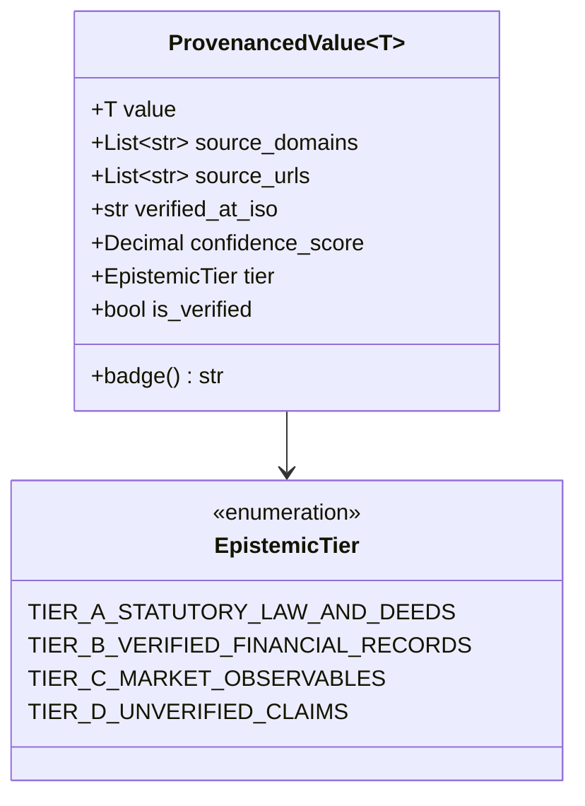
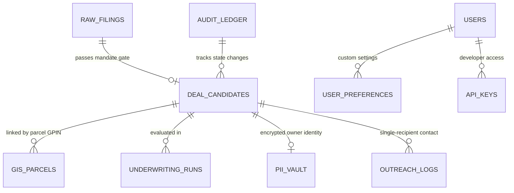

# Data Models, Epistemic Provenance & Database Schema
**Argus (v1.0) — Autonomous Asset Intelligence, Sourcing & Underwriting Platform**

---

## 1. Epistemic Provenance Core Types (`packages/core_types/provenance.py`)

Every valuation, metric, and data point displayed to the Principal must carry verifiable provenance according to the 4-tier epistemic hierarchy.



### Hierarchy Rules:
1. **Tier A (Statutory Law & Deeds)**: Recorded deeds of trust, county GIS tax assessor parcels, court filings, federal statutes. Confidence: `0.95 - 1.00`.
2. **Tier B (Verified Financials)**: IRS tax returns (Schedule C, 1120-S, 1065), CPA-reviewed financial statements, lender payoff letters. Confidence: `0.85 - 0.95`.
3. **Tier C (Market Observables)**: CoStar / LoopNet commercial comps, broker listings, published auction notices. Confidence: `0.70 - 0.85`.
4. **Tier D (Unverified / Guru Claims)**: Seller verbal add-backs, broker pro-forma assertions. Disallowed from base DSCR calculations. If unverified, confidence is `< 0.70` and the badge displays `[UNPROVEN — REQUIRES DILIGENCE]`.

### Dual-Source Verification Gate:
A data point is only marked `is_verified = True` when:
- `len(set(source_domains)) >= 2` (At least two distinct, independent domain names, e.g. `arcgis.roanokeva.gov` and `cis.scc.virginia.gov`).
- `confidence_score >= 0.80`.

---

## 2. Air-Gapped Underwriting Solvers (`packages/underwriting_engine/`)

All underwriting calculations are strictly pure Python `decimal.Decimal` with `ROUND_HALF_EVEN`. Floating point numbers (`float`) are completely forbidden.

### SBA SOP 50 10 8.1 Data Structure (`sba_sop_50_10_8_1.py`)

```python
@dataclass(frozen=True)
class SBASOP501081Input:
    purchase_price: Decimal
    historical_ebitda: Decimal
    audited_addbacks: Decimal
    proposed_debt_annual_service: Decimal
    buyer_cash_injection: Decimal
    seller_full_standby_note: Decimal
    seller_standby_months: int  # Must be >= 36 months
    seller_consulting_months: int  # Must be <= 24 months
    appraised_owner_occupied_cre_value: Decimal = Decimal("0")

@dataclass(frozen=True)
class SBASOP501081Result:
    historical_dscr: Decimal
    projected_dscr: Decimal
    is_dscr_compliant: bool  # historical_dscr >= 1.25
    total_project_cost: Decimal
    total_equity_injection: Decimal
    equity_injection_percentage: Decimal
    is_equity_percentage_compliant: bool  # >= 10.0%
    limited_equity_percentage: Decimal  # seller note <= 50.0% of total injection
    is_limited_equity_compliant: bool
    is_standby_compliant: bool  # standby_months >= 36
    is_consulting_compliant: bool  # consulting_months <= 24
    requires_independent_qoe: bool  # loan >= $3,000,000 net of appraised CRE
    overall_sba_compliant: bool
```

### Virginia Foreclosure Solver (`va_foreclosure_solver.py`)

```python
@dataclass(frozen=True)
class VirginiaForeclosureInput:
    total_cure_or_acquisition_basis: Decimal
    verified_assessed_cre_value: Decimal
    notice_date: str  # ISO 8601
    scheduled_trustee_sale_date: str  # ISO 8601

@dataclass(frozen=True)
class VirginiaForeclosureResult:
    notice_days_provided: int
    is_notice_compliant: bool  # notice_days >= 14 (Va. Code § 55.1-321)
    basis_to_value_ratio: Decimal
    is_basis_ratio_compliant: bool  # basis_to_value_ratio <= 0.70
    overall_foreclosure_compliant: bool
```

---

## 3. Relational Database Schema (PostgreSQL 16 + PostGIS)

The production schema is defined in [`services/api/migrations/001_initial_schema_rls.sql`](file:///C:/Users/sajal/OneDrive/Desktop/Project%20Asset%20Aggregator/services/api/migrations/001_initial_schema_rls.sql) and [`002_user_auth_management.sql`](file:///C:/Users/sajal/OneDrive/Desktop/Project%20Asset%20Aggregator/services/api/migrations/002_user_auth_management.sql).



### Key Tables & Column Specifications:

#### 1. `raw_filings`
Ingests all uncurated records from court RSS, public notices, and tax sales.
- `filing_id` (`VARCHAR(64)` PRIMARY KEY)
- `source_domain` (`VARCHAR(128)` NOT NULL)
- `docket_number` (`VARCHAR(64)`)
- `filing_date` (`DATE` NOT NULL)
- `debtor_name` (`VARCHAR(255)` NOT NULL)
- `raw_address` (`TEXT`)
- `fips_code` (`VARCHAR(5)`)
- `estimated_claim_amount` (`NUMERIC(14,2)`)
- `mandate_stage1_decision` (`VARCHAR(32)`): `PASS`, `REJECTED_HARD_FILTER`, `QUARANTINE_NEAR_MISS`.
- `created_at` (`TIMESTAMPTZ` DEFAULT `NOW()`)

#### 2. `deal_candidates`
Curated deals that have survived the zero-cost Stage 1 and Stage 2 filter.
- `deal_id` (`VARCHAR(64)` PRIMARY KEY)
- `filing_id` (`VARCHAR(64)` REFERENCES `raw_filings(filing_id)`)
- `business_name` (`VARCHAR(255)` NOT NULL)
- `fips_code` (`VARCHAR(5)` NOT NULL) - e.g. `51770` (Roanoke City), `51161` (Roanoke County).
- `naics_code` (`VARCHAR(6)` NOT NULL) - e.g. `332710`, `447110`, `484110`.
- `pipeline_stage` (`VARCHAR(32)` NOT NULL): `INGESTED`, `ENRICHED`, `UNDERWRITTEN`, `APPROVED`, `OUTREACHED`.
- `historical_dscr` (`NUMERIC(5,2)`)
- `stressed_dscr` (`NUMERIC(5,2)`)
- `basis_to_value_ratio` (`NUMERIC(5,2)`)
- `provenance_confidence` (`NUMERIC(3,2)`)
- `is_dual_source_verified` (`BOOLEAN` DEFAULT `FALSE`)
- `created_at` (`TIMESTAMPTZ` DEFAULT `NOW()`)

#### 3. `gis_parcels`
GIS parcel geometries and tax assessor valuations normalized from ArcGIS REST servers.
- `parcel_gpin` (`VARCHAR(32)` PRIMARY KEY)
- `fips_code` (`VARCHAR(5)` NOT NULL)
- `jurisdiction` (`VARCHAR(64)` NOT NULL)
- `land_value_usd` (`NUMERIC(14,2)`)
- `building_value_usd` (`NUMERIC(14,2)`)
- `total_assessed_value_usd` (`NUMERIC(14,2)`)
- `zoning_code` (`VARCHAR(32)`)
- `geometry` (`GEOMETRY(MultiPolygon, 4326)`) - PostGIS spatial column for centroid and radius queries.
- `fema_flood_zone` (`VARCHAR(16)`)
- `last_synced_at` (`TIMESTAMPTZ`)

#### 4. `owner_pii_vault` (Encrypted)
Encrypted store isolating owner contact information from public views.
- `vault_id` (`VARCHAR(64)` PRIMARY KEY)
- `deal_id` (`VARCHAR(64)` UNIQUE REFERENCES `deal_candidates(deal_id)`)
- `encrypted_owner_name` (`BYTEA` NOT NULL) - AES-256 GCM encrypted.
- `encrypted_phone` (`BYTEA`)
- `encrypted_email` (`BYTEA`)
- `initialization_vector` (`BYTEA` NOT NULL)
- `auth_tag` (`BYTEA` NOT NULL)
- `created_at` (`TIMESTAMPTZ` DEFAULT `NOW()`)

#### 5. `immutable_audit_ledger` (Merkle Hash Chain)
Append-only tamper-evident audit record for all fiduciary actions.
- `entry_id` (`BIGSERIAL` PRIMARY KEY)
- `timestamp_iso` (`VARCHAR(32)` NOT NULL)
- `actor_role` (`VARCHAR(32)` NOT NULL)
- `actor_user_id` (`VARCHAR(64)` NOT NULL)
- `action_type` (`VARCHAR(64)` NOT NULL) - e.g. `PRINCIPAL_APPROVE`, `COUNSEL_SIGNOFF`, `DISPATCH_OUTREACH`.
- `deal_id` (`VARCHAR(64)`)
- `payload_json` (`JSONB` NOT NULL)
- `previous_block_hash` (`VARCHAR(64)` NOT NULL)
- `merkle_record_hash` (`VARCHAR(64)` NOT NULL) - SHA-256 of `(previous_block_hash + payload + timestamp)`.
