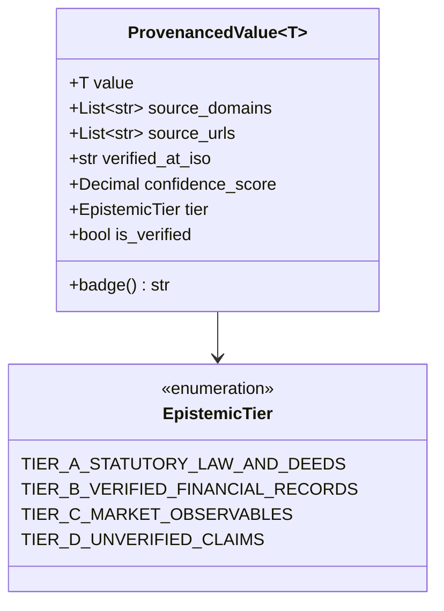
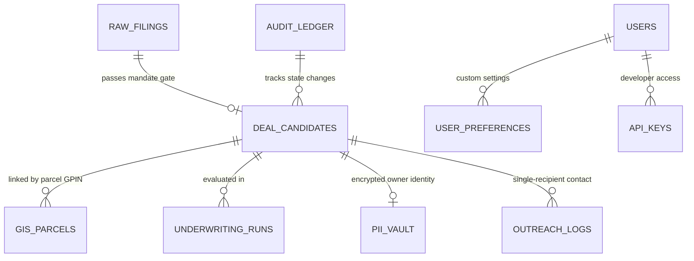

# Data Models, Epistemic Provenance & Database Schema
**Argus (v1.0) — Autonomous Asset Intelligence, Sourcing & Underwriting Platform**

---

## 1. Epistemic Provenance Core Types (`packages/core_types/provenance.py`)

Every valuation, metric, and data point displayed to the Principal must carry verifiable provenance according to the 4-tier epistemic hierarchy.



### Hierarchy Rules:
1. **Tier A (Statutory Law & Deeds)**: Recorded deeds of trust, county GIS tax assessor parcels, court filings, federal statutes. Confidence: `0.95 - 1.00`.
2. **Tier B (Verified Financials)**: IRS tax returns (Schedule C, 1120-S, 1065), CPA-reviewed financial statements, lender payoff letters. Confidence: `0.85 - 0.95`.
3. **Tier C (Market Observables)**: CoStar / LoopNet commercial comps, broker listings, published auction notices. Confidence: `0.70 - 0.85`.
4. **Tier D (Unverified / Guru Claims)**: Seller verbal add-backs, broker pro-forma assertions. Disallowed from base DSCR calculations. If unverified, confidence is `< 0.70` and the badge displays `[UNPROVEN — REQUIRES DILIGENCE]`.

### Dual-Source Verification Gate:
A data point is only marked `is_verified = True` when:
- `len(set(source_domains)) >= 2` (At least two distinct, independent domain names, e.g. `arcgis.roanokeva.gov` and `cis.scc.virginia.gov`).
- `confidence_score >= 0.80`.

---

## 2. Air-Gapped Underwriting Solvers (`packages/underwriting_engine/`)

All underwriting calculations are strictly pure Python `decimal.Decimal` with `ROUND_HALF_EVEN`. Floating point numbers (`float`) are completely forbidden.

### SBA SOP 50 10 8.1 Data Structure (`sba_sop_50_10_8_1.py`)

```python
@dataclass(frozen=True)
class SBASOP501081Input:
    purchase_price: Decimal
    historical_ebitda: Decimal
    audited_addbacks: Decimal
    proposed_debt_annual_service: Decimal
    buyer_cash_injection: Decimal
    seller_full_standby_note: Decimal
    seller_standby_months: int  # Must be >= 36 months
    seller_consulting_months: int  # Must be <= 24 months
    appraised_owner_occupied_cre_value: Decimal = Decimal("0")

@dataclass(frozen=True)
class SBASOP501081Result:
    historical_dscr: Decimal
    projected_dscr: Decimal
    is_dscr_compliant: bool  # historical_dscr >= 1.25
    total_project_cost: Decimal
    total_equity_injection: Decimal
    equity_injection_percentage: Decimal
    is_equity_percentage_compliant: bool  # >= 10.0%
    limited_equity_percentage: Decimal  # seller note <= 50.0% of total injection
    is_limited_equity_compliant: bool
    is_standby_compliant: bool  # standby_months >= 36
    is_consulting_compliant: bool  # consulting_months <= 24
    requires_independent_qoe: bool  # loan >= $3,000,000 net of appraised CRE
    overall_sba_compliant: bool
```

### Virginia Foreclosure Solver (`va_foreclosure_solver.py`)

```python
@dataclass(frozen=True)
class VirginiaForeclosureInput:
    total_cure_or_acquisition_basis: Decimal
    verified_assessed_cre_value: Decimal
    notice_date: str  # ISO 8601
    scheduled_trustee_sale_date: str  # ISO 8601

@dataclass(frozen=True)
class VirginiaForeclosureResult:
    notice_days_provided: int
    is_notice_compliant: bool  # notice_days >= 14 (Va. Code § 55.1-321)
    basis_to_value_ratio: Decimal
    is_basis_ratio_compliant: bool  # basis_to_value_ratio <= 0.70
    overall_foreclosure_compliant: bool
```

---

## 3. Relational Database Schema (PostgreSQL 16 + PostGIS)

The production schema is defined in [`services/api/migrations/001_initial_schema_rls.sql`](file:///C:/Users/sajal/OneDrive/Desktop/Project%20Asset%20Aggregator/services/api/migrations/001_initial_schema_rls.sql) and [`002_user_auth_management.sql`](file:///C:/Users/sajal/OneDrive/Desktop/Project%20Asset%20Aggregator/services/api/migrations/002_user_auth_management.sql).



### Key Tables & Column Specifications:

#### 1. `raw_filings`
Ingests all uncurated records from court RSS, public notices, and tax sales.
- `filing_id` (`VARCHAR(64)` PRIMARY KEY)
- `source_domain` (`VARCHAR(128)` NOT NULL)
- `docket_number` (`VARCHAR(64)`)
- `filing_date` (`DATE` NOT NULL)
- `debtor_name` (`VARCHAR(255)` NOT NULL)
- `raw_address` (`TEXT`)
- `fips_code` (`VARCHAR(5)`)
- `estimated_claim_amount` (`NUMERIC(14,2)`)
- `mandate_stage1_decision` (`VARCHAR(32)`): `PASS`, `REJECTED_HARD_FILTER`, `QUARANTINE_NEAR_MISS`.
- `created_at` (`TIMESTAMPTZ` DEFAULT `NOW()`)

#### 2. `deal_candidates`
Curated deals that have survived the zero-cost Stage 1 and Stage 2 filter.
- `deal_id` (`VARCHAR(64)` PRIMARY KEY)
- `filing_id` (`VARCHAR(64)` REFERENCES `raw_filings(filing_id)`)
- `business_name` (`VARCHAR(255)` NOT NULL)
- `fips_code` (`VARCHAR(5)` NOT NULL) - e.g. `51770` (Roanoke City), `51161` (Roanoke County).
- `naics_code` (`VARCHAR(6)` NOT NULL) - e.g. `332710`, `447110`, `484110`.
- `pipeline_stage` (`VARCHAR(32)` NOT NULL): `INGESTED`, `ENRICHED`, `UNDERWRITTEN`, `APPROVED`, `OUTREACHED`.
- `historical_dscr` (`NUMERIC(5,2)`)
- `stressed_dscr` (`NUMERIC(5,2)`)
- `basis_to_value_ratio` (`NUMERIC(5,2)`)
- `provenance_confidence` (`NUMERIC(3,2)`)
- `is_dual_source_verified` (`BOOLEAN` DEFAULT `FALSE`)
- `created_at` (`TIMESTAMPTZ` DEFAULT `NOW()`)

#### 3. `gis_parcels`
GIS parcel geometries and tax assessor valuations normalized from ArcGIS REST servers.
- `parcel_gpin` (`VARCHAR(32)` PRIMARY KEY)
- `fips_code` (`VARCHAR(5)` NOT NULL)
- `jurisdiction` (`VARCHAR(64)` NOT NULL)
- `land_value_usd` (`NUMERIC(14,2)`)
- `building_value_usd` (`NUMERIC(14,2)`)
- `total_assessed_value_usd` (`NUMERIC(14,2)`)
- `zoning_code` (`VARCHAR(32)`)
- `geometry` (`GEOMETRY(MultiPolygon, 4326)`) - PostGIS spatial column for centroid and radius queries.
- `fema_flood_zone` (`VARCHAR(16)`)
- `last_synced_at` (`TIMESTAMPTZ`)

#### 4. `owner_pii_vault` (Encrypted)
Encrypted store isolating owner contact information from public views.
- `vault_id` (`VARCHAR(64)` PRIMARY KEY)
- `deal_id` (`VARCHAR(64)` UNIQUE REFERENCES `deal_candidates(deal_id)`)
- `encrypted_owner_name` (`BYTEA` NOT NULL) - AES-256 GCM encrypted.
- `encrypted_phone` (`BYTEA`)
- `encrypted_email` (`BYTEA`)
- `initialization_vector` (`BYTEA` NOT NULL)
- `auth_tag` (`BYTEA` NOT NULL)
- `created_at` (`TIMESTAMPTZ` DEFAULT `NOW()`)

#### 5. `immutable_audit_ledger` (Merkle Hash Chain)
Append-only tamper-evident audit record for all fiduciary actions.
- `entry_id` (`BIGSERIAL` PRIMARY KEY)
- `timestamp_iso` (`VARCHAR(32)` NOT NULL)
- `actor_role` (`VARCHAR(32)` NOT NULL)
- `actor_user_id` (`VARCHAR(64)` NOT NULL)
- `action_type` (`VARCHAR(64)` NOT NULL) - e.g. `PRINCIPAL_APPROVE`, `COUNSEL_SIGNOFF`, `DISPATCH_OUTREACH`.
- `deal_id` (`VARCHAR(64)`)
- `payload_json` (`JSONB` NOT NULL)
- `previous_block_hash` (`VARCHAR(64)` NOT NULL)
- `merkle_record_hash` (`VARCHAR(64)` NOT NULL) - SHA-256 of `(previous_block_hash + payload + timestamp)`.

---

## 7. Palantir Operational Ontology & Gotham Link Graph Contracts

### `OntologyNodeType` & `OntologyEdgeType`
- Node Types: `ENTITY_CORPORATE`, `NATURAL_PERSON`, `REAL_ESTATE_PARCEL`, `EQUIPMENT_ASSET`, `COURT_DOCKET`, `LIEN_DEED_OF_TRUST`, `FIDUCIARY_TRUSTEE`, `FINANCIAL_LENDER`.
- Edge Types: `OWNS_EQUITY`, `OFFICER_OR_DIRECTOR`, `TITLED_OWNER_OF_PARCEL`, `EQUIPMENT_LOCATED_AT`, `SECURED_BY_LIEN`, `PERSONAL_GUARANTOR_OF`, `SUBSTITUTE_TRUSTEE_FOR`, `BANKRUPTCY_DEBTOR_IN`, `CROSS_COLLATERALIZED_WITH`.

### `OntologyGraphReport`
- `asset_id`: Target distressed asset / corporate identifier.
- `total_nodes` (`int`), `total_edges` (`int`): Graph size metrics.
- `nodes` (`List[OntologyNodeRecord]`): Semantic entities with confidence scores and provenance URLs.
- `edges` (`List[OntologyEdgeRecord]`): Directed links with weights, legal instruments, and properties.
- `leverage_hub_node_id` (`str`), `leverage_hub_role` (`str`): Primary betweenness centrality leverage node.
- `cross_collateralization_detected` (`bool`): Cycle or multi-parcel encumbrance indicator.
- `shortest_leverage_path` (`List[str]`): Sequential workout route from buyer to trustee.
- `graph_density` (`Decimal`): Network connectivity density quantized to 0.0001.
- `executive_intel_summary` (`str`): Legal and epistemic executive synthesis.

### `EntityResolutionMatchResult` (Splink / Fellegi-Sunter)
- `source_record_id`, `candidate_record_id`: Matched record IDs.
- `match_probability` (`Decimal`): 0.00 to 1.00 probabilistic score.
- `match_tier` (`str`): `"CERTAIN"`, `"HIGH_PROBABILITY"`, `"POSSIBLE_ASSOCIATION"`, `"DISTINCT"`.
- `jaro_winkler_name_score` (`Decimal`), `address_similarity_score` (`Decimal`).
- `tax_id_exact_match` (`bool`), `is_merged` (`bool`), `canonical_entity_id` (`str`).
- `epistemic_reasoning` (`str`): Epistemic explanation of linkage.

### `TopologicalParcelFusionReport` (Gaia / Shapely)
- `parcel_id`: Target GPIN.
- `parcel_area_acres` (`Decimal`), `building_footprint_sqft` (`Decimal`).
- `setback_encroachment_detected` (`bool`): Building infringement on statutory boundary setbacks (<15ft).
- `floodway_intersection_sqft` (`Decimal`), `flood_coverage_pct` (`Decimal`).
- `contiguous_roll_up_candidate_parcels` (`List[str]`): Adjoining parcels under common ownership.
- `rail_spur_adjacent` (`bool`): Proximity to active Norfolk Southern rail corridor (<=150ft).

### `ContourAnalyticalQueryResult` (Foundry Contour / DuckDB)
- `query_description`: Natural language filter summary.
- `matched_records_count` (`int`).
- `execution_time_ms` (`Decimal`): Sub-50ms execution latency metric.
- `aggregate_ebitda_usd` (`Decimal`), `aggregate_cure_basis_usd` (`Decimal`).
- `records`: Filtered columnar records.

---

## 8. Sourcing Intelligence & Debt Radar Models (Inven / Trepp / PropertyRadar / Cherre)

### `LookalikeMatchResult` & `SemanticLookalikeReport` (Inven-Grade Sourcing)
- `candidate_id` (`str`), `company_name` (`str`), `naics_code` (`str`), `industry_description` (`str`).
- `semantic_similarity_score` (`Decimal`): 0.00 to 1.00 cosine/Jaccard similarity.
- `estimated_ebitda_usd` (`Decimal`), `estimated_asking_basis_usd` (`Decimal`).
- `distance_miles` (`Decimal`), `city_and_state` (`str`).
- `operational_thesis` (`str`): Quantitative fit narrative.
- `contact_fiduciary_type` (`str`): Designated warm fiduciary (`SUBSTITUTE_TRUSTEE`, `COMMERCIAL_BROKER`, `MANAGING_PARTNER`).
- `SemanticLookalikeReport`: Container with `query_text`, `exemplary_entity_id`, `total_matched`, `candidates`, and `executive_summary`.

### `MaturityWallLoanRecord` & `DebtMaturityRadarReport` (Reonomy/Trepp Debt Radar)
- `loan_id` (`str`), `borrower_name` (`str`), `parcel_id` (`str`).
- `original_principal_usd` (`Decimal`), `current_balance_usd` (`Decimal`), `origination_year` (`int`), `maturity_date_iso` (`str`).
- `origination_coupon_pct` (`Decimal`), `projected_refinance_coupon_pct` (`Decimal`).
- `historical_ebitda_usd` (`Decimal`), `current_annual_debt_service_usd` (`Decimal`), `projected_annual_debt_service_usd` (`Decimal`).
- `current_dscr` (`Decimal`), `refinanced_dscr` (`Decimal`), `refinance_cliff_score` (`Decimal`, 0.00 to 100.00).
- `distress_tier` (`DistressMaturityTier`): `IMMINENT_DEFAULT`, `HIGH_REFINANCE_STRESS`, `MODERATE_PRESSURE`, `STABLE_COVERAGE`.
- `months_to_maturity` (`int`).
- `DebtMaturityRadarReport`: Aggregated report with `total_loans_tracked`, `total_maturing_debt_volume_usd`, `high_stress_loans_count`, `loans`, and `refinance_stress_thesis`.

### `TitleLienRecord` & `TitleCurativeAuditReport` (PropertyRadar Title Curative)
- `lien_id` (`str`), `lien_type` (`str`), `recording_instrument_no` (`str`), `recorded_date_iso` (`str`).
- `claimed_amount_usd` (`Decimal`), `is_senior_priority` (`bool`), `statutory_redemption_period_days` (`int`).
- `redemption_deadline_iso` (`Optional[str]`), `is_blocking_clearance` (`bool`), `curative_action_required` (`str`).
- `TitleCurativeAuditReport`: Container with `title_status` (`TITLE_MARKETABLE_INSURABLE`, `TITLE_CLOUDED_REDEMPTION_RISK`, `TITLE_FATAL_SUPERIOR_LIEN`), `is_clearance_blocked` (`bool`), `total_encumbrance_basis_usd` (`Decimal`), `irs_120_day_redemption_active` (`bool`, 26 U.S.C. § 7425), `irs_redemption_days_remaining` (`int`), `recommended_escrow_holdback_usd` (`Decimal`), `liens`, and `counsel_closing_opinion`.

### `BuildingPermitRecord` & `ZoningEnvelopeReport` (Cherre/Bowery Municipal Permits & FAR)
- `permit_id` (`str`), `issue_date_iso` (`str`), `permit_type` (`str`), `estimated_valuation_usd` (`Decimal`), `status` (`str`), `contractor_name` (`str`), `description` (`str`).
- `ZoningEnvelopeReport`: Container with `parcel_id`, `zone_code`, `zone_description`, `permitted_use_status` (`PERMITTED_BY_RIGHT`, `LEGAL_NON_CONFORMING_GRANDFATHERED`, `SPECIAL_USE_PERMIT_REQUIRED`), `parcel_sqft` (`Decimal`), `building_footprint_sqft` (`Decimal`), `max_allowable_far` (`Decimal`), `current_far` (`Decimal`), `expansion_potential_sqft` (`Decimal`), `open_permit_citations_count` (`int`), `permits`, `unpermitted_alteration_risk_detected` (`bool`), and `analyst_zoning_summary`.

---

## 9. Institutional Titan Data Models (Goldman Sachs / BlackRock / Vanguard / Jane Street / Bridgewater)

### `DAGNodeState` & `DAGEvaluationReport` (Goldman SecDB / Athena Reactive DAG)
- `node_id` (`str`), `node_type` (`DAGNodeType`: `INPUT`, `FORMULA`, `HURDLE`), `label` (`str`), `dependencies` (`List[str]`), `dependents` (`List[str]`), `cached_value` (`Optional[str]`), `is_dirty` (`bool`), `unit` (`str`), `description` (`str`).
- `DAGEvaluationReport`: Container with `evaluation_id` (`str`), `timestamp_iso` (`str`), `inputs` (`Dict[str, str]`), `computed_formulas` (`Dict[str, str]`), `hurdle_evaluations` (`Dict[str, bool]`), `is_sba_compliant` (`bool`), `is_va_foreclosure_compliant` (`bool`), `is_principal_hurdle_passed` (`bool`), `dirty_nodes_recalculated_count` (`int`), `total_dag_nodes_count` (`int`), `execution_time_microseconds` (`int`), `incremental_efficiency_pct` (`str`), and `executive_synthesis` (`str`).

### `WaterfallTierResult`, `PEWaterfallReport` & `PortfolioAllocationReport` (BlackRock eFront & Citadel)
- `WaterfallTierResult`: `tier_number` (`int`), `tier_name` (`str`), `description` (`str`), `lp_distribution_usd` (`str`), `gp_distribution_usd` (`str`), `total_tier_distribution_usd` (`str`), `remaining_distributable_usd` (`str`).
- `PEWaterfallReport`: `deal_id` (`str`), `waterfall_structure` (`WaterfallStructure`: `EUROPEAN_WHOLE_FUND`, `AMERICAN_DEAL_BY_DEAL`), `total_equity_contributed_usd` (`str`), `lp_equity_contributed_usd` (`str`), `gp_equity_contributed_usd` (`str`), `preferred_return_rate_pct` (`str`), `holding_period_years` (`str`), `total_distributable_proceeds_usd` (`str`), `lp_total_received_usd` (`str`), `gp_total_received_usd` (`str`), `lp_moic` (`str`), `gp_moic` (`str`), `lp_annualized_roi_pct` (`str`), `gp_carried_interest_usd` (`str`), `tier_breakdown` (`List[WaterfallTierResult]`), and `cpa_waterfall_opinion` (`str`).
- `ConcentrationLimitRule`: `rule_name` (`str`), `dimension_type` (`str`), `target_identifier` (`str`), `max_allowable_allocation_pct` (`str`), `current_allocation_pct` (`str`), `current_deployed_usd` (`str`), `is_breached` (`bool`), and `remedial_action` (`str`).
- `PortfolioAllocationReport`: `report_id` (`str`), `as_of_date_iso` (`str`), `total_committed_family_capital_usd` (`str`), `total_deployed_equity_usd` (`str`), `dry_powder_liquidity_usd` (`str`), `dry_powder_ratio_pct` (`str`), `active_deals_count` (`int`), `is_all_concentration_limits_compliant` (`bool`), `concentration_rules` (`List[ConcentrationLimitRule]`), `capital_call_schedule` (`List[CapitalCallMilestone]`), and `principal_risk_summary` (`str`).

### `Section1031ExchangeReport` & `CostSegregationAnalysisReport` (Vanguard & CPA Tax Alpha)
- `Section1031IdentificationRecord`: `candidate_id` (`str`), `property_address` (`str`), `county_fips` (`str`), `estimated_purchase_price_usd` (`str`), `identified_date_iso` (`str`), `is_within_45_days` (`bool`), `rule_category` (`str`).
- `Section1031ExchangeReport`: Container with `exchange_id` (`str`), `relinquished_property_name` (`str`), `sale_closing_date_iso` (`str`), `sale_price_usd` (`str`), `adjusted_cost_basis_usd` (`str`), `existing_mortgage_payoff_usd` (`str`), `net_equity_proceeds_usd` (`str`), `statutory_45_day_deadline_iso` (`str`), `statutory_180_day_deadline_iso` (`str`), `days_remaining_45d_id` (`int`), `days_remaining_180d_close` (`int`), `is_id_window_active` (`bool`), `is_exchange_active` (`bool`), `identified_properties` (`List[Section1031IdentificationRecord]`), `projected_tax_deferral_usd` (`str`), `effective_capital_gains_rate_pct` (`str`), and `tax_opinion_summary` (`str`).
- `CostSegregationClassAllocation`: `asset_class` (`MACRSAssetClass`), `description` (`str`), `allocated_basis_usd` (`str`), `allocation_pct` (`str`), `bonus_depreciation_pct` (`str`), `year_1_depreciation_usd` (`str`).
- `CostSegregationAnalysisReport`: Container with `parcel_id`, `deal_id`, `total_acquisition_basis_usd`, `land_value_non_depreciable_usd`, `depreciable_basis_usd`, `class_allocations` (`List[CostSegregationClassAllocation]`), `year_1_accelerated_deduction_usd`, `year_1_straight_line_deduction_usd`, `first_year_additional_deduction_usd`, `marginal_tax_rate_pct`, `year_1_cash_tax_savings_usd`, `npv_5yr_tax_benefit_usd`, and `cpa_tax_opinion`.

### `CanonicalEvent` & `ReplayLedgerReport` (Jane Street Deterministic Canonical SMR)
- `CanonicalEvent`: `sequence_no` (`int`), `timestamp_iso` (`str`), `event_type` (`CanonicalEventType`), `aggregate_id` (`str`), `actor_role` (`str`), `payload_data` (`Dict[str, Any]`), `payload_hash` (`str`), `parent_hash` (`str`), `event_hash` (`str`).
- `ReplayLedgerReport`: `replay_id` (`str`), `total_events_replayed` (`int`), `tip_sequence_no` (`int`), `tip_event_hash` (`str`), `is_hash_chain_valid` (`bool`), `reconstructed_state` (`Dict[str, Any]`), `earliest_event_timestamp` (`str`), `latest_event_timestamp` (`str`), and `statutory_audit_opinion` (`str`).

### `QuadrantStressResult` & `BridgewaterMacroRegimeReport` (Dalio 4-Quadrant Macro Tester)
- `QuadrantStressResult`: `quadrant` (`MacroEconomicQuadrant`), `regime_name` (`str`), `growth_trend` (`str`), `inflation_trend` (`str`), `revenue_shock_pct` (`str`), `input_cost_inflation_pct` (`str`), `rate_shock_bps` (`str`), `stressed_revenue_usd` (`str`), `stressed_ebitda_usd` (`str`), `stressed_annual_debt_service_usd` (`str`), `stressed_dscr` (`str`), `solvency_status` (`str`: `ROBUST_SOLVENT`, `MARGINAL_STRESS`, `INSOLVENT_DEFAULT`), and `resilience_points` (`int`).
- `BridgewaterMacroRegimeReport`: Container with `deal_id`, `entity_name`, `naics_code`, `base_revenue_usd`, `base_ebitda_usd`, `base_annual_debt_service_usd`, `base_dscr`, `composite_resilience_score`, `all_weather_grade`, `quadrant_results` (`List[QuadrantStressResult]`), `most_severe_threat_quadrant`, `recommended_hedging_strategy`, and `dalio_macro_synthesis`.


