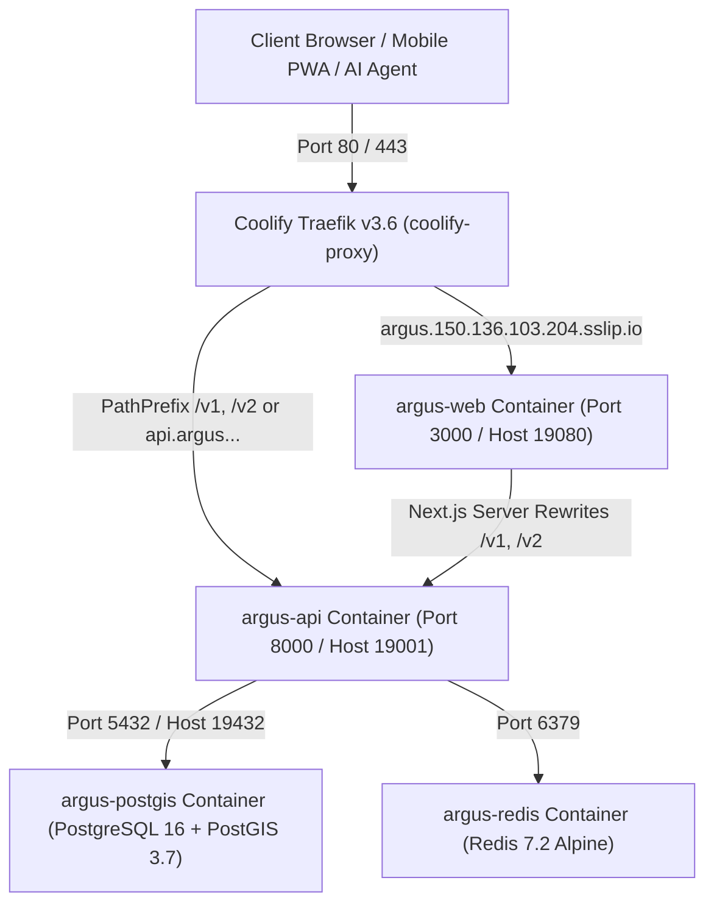

# Operations, Infrastructure & VPS Deployment Guide
**Argus (v1.0) — Autonomous Asset Intelligence, Sourcing & Underwriting Platform**

---

## 1. Live Production Deployment on Oracle OCI ARM64 & Coolify

Argus (v1.0) is actively deployed and running on an **Oracle Cloud Infrastructure (OCI) Ampere A1 ARM64 VPS (12 GB RAM / 4 OCPU, Ubuntu 24.04 LTS)** managed under **Coolify 4.7.5**.

### Live Access Endpoints & Network Topology:
- **Web Dashboard (PWA)**: [`http://argus.150.136.103.204.sslip.io`](http://argus.150.136.103.204.sslip.io) *(Standard Port 80 via Traefik)*
- **Direct Web Host Port**: `http://150.136.103.204:19080`
- **FastAPI Backend (Subdomain)**: [`http://api.argus.150.136.103.204.sslip.io/v1/health`](http://api.argus.150.136.103.204.sslip.io/v1/health) *(Standard Port 80 via Traefik)*
- **FastAPI Direct Host Port**: `http://150.136.103.204:19001/v1/health`
- **Coolify Admin UI**: `http://150.136.103.204:8000` (Project **Argus**, Service **argus-stack**)



---

## 2. Multi-Container Stack Specification (`docker-compose.coolify.yml`)

The production deployment runs via [`docker-compose.coolify.yml`](file:///C:/Users/sajal/OneDrive/Desktop/Project%20Asset%20Aggregator/docker-compose.coolify.yml):

| Service | Container Name | Image / Base | Host Port | Internal Port | Memory Limits | Healthcheck |
| :--- | :--- | :--- | :--- | :--- | :--- | :--- |
| **`web`** | `argus-web` | `argus-web:latest` (Node 20 Alpine Standalone) | `19080:3000` | `3000` | ~150 MB | `wget -qO- http://127.0.0.1:3000` (IPv4) |
| **`api`** | `argus-api` | `argus-api:latest` (Python 3.11 Bookworm + Uvicorn) | `19001:8000` | `8000` | ~220 MB | `curl -f http://localhost:8000/v1/health` |
| **`postgis`** | `argus-postgis` | `argus-postgis:latest` (PG 16 + PostGIS 3.7) | `127.0.0.1:19432:5432` | `5432` | ~512 MB shared | `pg_isready -U argus_admin -d argus_db` |
| **`redis`** | `argus-redis` | `redis:7.2-alpine` | Private Network | `6379` | ~60 MB | `redis-cli ping` |

### Volume Persistence & Database Initialization:
1. **`argus_postgis_data`**: Durable Docker volume for Postgres data directory (`/var/lib/postgresql/data`).
2. **`argus_redis_data`**: Durable Docker volume for Redis AOF logs (`/data`).
3. **`/docker-entrypoint-initdb.d`**: Mounts `services/api/migrations` on boot; runs [`001_initial_schema_rls.sql`](file:///C:/Users/sajal/OneDrive/Desktop/Project%20Asset%20Aggregator/services/api/migrations/001_initial_schema_rls.sql) to initialize PostGIS, Row Level Security, and seed mandate `ROA-SMB-01`.

---

## 3. Coolify 4.7.5 Integration & Dynamic Traefik Ingress

### Coolify Registration:
- **Project Name**: `Argus` (`UUID: weju8zsunkbu7uszqyq8wuzf`)
- **Service Name**: `argus-stack` (`UUID: hdzdjyn3gmtpsulrp2x7urlz`)
- **Server**: `localhost` (`UUID: yjpgrtwlcnwqbjzuy85lgust`)

### Dynamic Traefik Configuration (`/data/coolify/proxy/dynamic/argus.yaml`):
Traefik dynamically watches file changes and routes HTTP requests without proxy reload:
```yaml
http:
  routers:
    argus-api-path-http:
      rule: "Host(`argus.150.136.103.204.sslip.io`) && (PathPrefix(`/v1`) || PathPrefix(`/v2`))"
      entryPoints: [http]
      priority: 100
      service: argus-api-svc
    argus-api-http:
      rule: "Host(`api.argus.150.136.103.204.sslip.io`)"
      entryPoints: [http]
      service: argus-api-svc
    argus-web-http:
      rule: "Host(`argus.150.136.103.204.sslip.io`)"
      entryPoints: [http]
      priority: 10
      service: argus-web-svc
  services:
    argus-web-svc:
      loadBalancer:
        servers: [{ url: "http://argus-web:3000" }]
    argus-api-svc:
      loadBalancer:
        servers: [{ url: "http://argus-api:8000" }]
```

---

## 4. Coexistence with Existing VPS Services

The Argus deployment operates in strict isolation and shares zero ports with existing production applications:
- **Uncollided Ports**:
  - `8000`: Coolify Dashboard (Untouched)
  - `80/443`: Coolify Traefik Proxy (Reused via dynamic host routing)
  - `5678`: n8n Workflow Automation (Untouched)
  - `8100`: Vault API (Untouched)
  - `8642 / 9119`: Hermes AI Agent (Untouched)
  - `8899`: Gather-store (Untouched)
  - `18001 / 18080`: Blackline Demo Stack (Untouched)
  - **Argus**: Uses `19001` (FastAPI), `19080` (Next.js), and `19432` (PostGIS localhost-only).


---

## 3. One-Time VPS Setup on Oracle OCI ARM64

### 1. Provision Instance
- Shape: `VM.Standard.A1.Flex` (4 OCPU, 12 GB RAM, 100 GB Boot Volume).
- OS: Ubuntu 24.04 LTS (AArch64).
- Networking: Open ports `80` and `443` in the OCI Security List.

### 2. Execute Bootstrap Script
Connect via SSH and execute the automated provisioner:
```bash
# Clone the repository
git clone https://github.com/your-org/asup-roanoke-v1.git /opt/asup-roanoke-v1
cd /opt/asup-roanoke-v1

# Make script executable and run setup
chmod +x scripts/provision_oci_arm64_vps.sh
./scripts/provision_oci_arm64_vps.sh
```

### What `provision_oci_arm64_vps.sh` Does:
1. Installs Docker CE (AArch64), `docker-compose-plugin`, Python 3.11, and build essentials.
2. Configures `ufw` firewall rules (permits SSH `22`, HTTP `80`, HTTPS `443`, blocks raw database ports `5432` and `6379` from public internet).
3. Creates persistent data volumes: `/var/lib/asup/postgres`, `/var/lib/asup/redis`, `/var/lib/asup/caddy_data`.
4. Copies `.env.prod.example` to `.env.prod` with auto-generated 64-character cryptographic secrets for `JWT_SECRET_KEY` and `PII_AES_KEY`.
5. Starts the production stack via `docker compose -f docker-compose.prod.yml up -d --build`.
6. Executes database migrations in `services/api/migrations/001_initial_schema_rls.sql`.

---

## 4. CI/CD Deployment Pipeline (`.github/workflows/ci-deploy.yml`)

The GitHub Actions workflow executes on every push to `main`:
1. **Stage 1 (Air-Gap AST Check)**: Verifies `tests/unit/test_ast_airgap.py` (0 floats, 0 unapproved network imports).
2. **Stage 2 (Unit & Statutory Verification)**: Verifies SBA SOP 50 10 8.1, Va. Code § 55.1-321, and add-back auditor.
3. **Stage 3 (Integration & Security)**: Executes all 16 Milestone integration suites.
4. **Stage 4 (Roanoke Golden Suite Backtest)**: Verifies 50/50 golden deals (0 false positives, >= 95% kill rate).
5. **Stage 5 (SSH Deploy to OCI VPS)**: Connects to VPS via SSH deploy key, pulls new container images or rebuilds natively, runs migrations, and checks `GET /v1/health`.

---

## 5. Rollback Procedures (< 60 Seconds)

If any production anomaly or test regression occurs on the live VPS:

```bash
# Execute rapid rollback script to previous Git commit SHA
cd /opt/asup-roanoke-v1
./scripts/rollback_vps.sh <TARGET_COMMIT_SHA>
```

### What `rollback_vps.sh` Does:
1. Validates that the target commit SHA passes all unit tests.
2. Checks out the target SHA.
3. Performs a zero-downtime rolling container rebuild and restart.
4. Verifies `GET /v1/health` returns `{"status":"healthy"}`.
5. If health check fails within 30 seconds, automatically reverts to the starting SHA.

---

## 6. Daily Operational Procedures & Maintenance

### 1. Ingestion Pollers (Daily `06:00 EST`)
Ingestion pollers run daily at `06:00 EST` via cron or Celery worker:
```bash
python -m services.ingestion.roanoke_docket_pollers
```
- Hard-capped PACER spend: Max `$3.00/day`.
- Ingested candidates are filtered through `packages/mandate_filter/mandate_engine.py`.

### 2. Upstream Dependency Check
Check for upstream open-source releases weekly or via CLI:
```bash
python scripts/sync_upstream_dependencies.py --discover --check
```
- If updates are found, run `python scripts/sync_upstream_dependencies.py --verify-tests` before merging.

### 3. Database Backup
Automated daily PostgreSQL dump:
```bash
docker exec -t asup-db pg_dump -U asup_admin asup_db | gzip > /opt/backups/asup_db_$(date +%Y%m%d).sql.gz
```

---

## 7. Verified Production VPS Environment & Staging Holding Policy

### 1. Host Specification & Access Configuration
- **Host / IP**: `150.136.103.204`
- **Hostname**: `free-instance`
- **Operating System**: Ubuntu 24.04.5 LTS (AArch64 / Linux arm64)
- **SSH User**: `ubuntu`
- **SSH Port**: `22` (default)
- **Authentication**: SSH key only (no password login).
- **SSH Key Path (Local)**: `"C:\Users\sajal\OneDrive\Desktop\Work\Funnel Bridge\Oracle OCI\ssh-key-2026-09-02.key"`
- **Verified Host Key Fingerprint**:
  ```text
  150.136.103.204 ED25519 SHA256:ECtuMNJ4kgoOKfhADUfToly6YIOJzPWvB68UoeC6Im4
  ```
- **Control Plane**: **Coolify v4.7.5** (`http://150.136.103.204:8000`), supported by PostgreSQL 15, Redis 7, Sentinel, and Traefik v3.6.
- **Root Filesystem**: 200 GiB volume (`/dev/sda1` 193 GiB total, ~54 GiB used, ~140 GiB free, ~28% capacity).

### 2. User Preference & Deployment Policy
> [!IMPORTANT]
> **STRICT DEPLOYMENT HOLDING POLICY**:
> This VPS is designated as the **target production hosting environment** for Argus (v1.0). However, per the user's explicit instructions:
> - **DO NOT deploy or copy Argus to this VPS yet.**
> - **DO NOT create, start, or modify any containers on the VPS.**
> - **DO NOT reconfigure Coolify or Traefik proxy on the VPS.**
> - **Deployment is on HOLD until the user explicitly signals that the product is 100% complete.**

### 3. Coexisting Services Protection Invariants
When deployment is eventually authorized by the user, the following isolation boundaries must be strictly observed:
1. **LIVE MONEY PATH IS OFF-LIMITS**: Never touch `dip-ladder-orders` or `dip-ladder-state` (real-money automated trading workflows).
2. **LIVE DEMOS & WORKFLOWS**: Never stop or restart `Blackline` (`frontend`, `api`, `searxng`), `n8n` automation, `gather-store`, `vault-api`, `Hermes`, or the 14-container `Supabase` stack.
3. **OpenClaw**: Must remain disabled.
4. **Coolify-First**: Deploy Argus cleanly within Coolify as a containerized stack without introducing competing reverse proxies or interfering with Traefik (ports 80/443).
